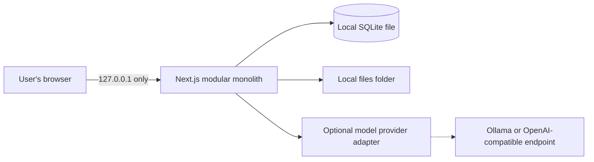

# Architecture

Vitae Stack is a local-only TypeScript modular monolith. A bundled Node.js process runs one Next.js web/API application on loopback. SQLite is embedded in that process; there is no database server, container runtime, or account service.

## Runtime boundaries

- React/Next.js renders the local UI and owns HTTP/API boundaries.
- Domain modules own career facts, documents, provenance, tailoring, ATS rules, portability, and deletion.
- `node:sqlite` provides transactions and relational constraints in one local file. Reviewed forward migrations live in `db/migrations/`.
- Uploaded source bytes and export artifacts use opaque names below the local files folder; metadata and hashes stay in SQLite.
- Parsing, secure URL retrieval, deletion, and current MVP jobs run locally with bounded work. Provider-specific AI code remains behind adapters.
- The server binds only to loopback and derives one trusted local principal. There are no sign-in, password, registration, or multi-user modes.

## Data and trust

Every generated factual claim references immutable approved evidence identifiers. Document versions and claim links are immutable snapshots. Manual edits that alter a factual claim invalidate its previous support until it is rematched. Inputs, imported files, fetched pages, templates, and model output are hostile data and are validated or sanitized at every boundary.

SQLite is a file-based design, not an external service: the structured store is `vitae.sqlite`, while large binary content is held in `files/`. This split keeps relationships and transactions reliable without hiding user data in containers or requiring an administrator.

Detailed contracts are indexed in [docs/README.md](docs/README.md). [ADR-0021](docs/adr/0021-local-sqlite-no-account-runtime.md) records the transition from the earlier server-oriented design.
