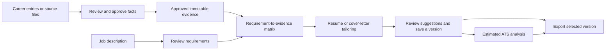

# Vitae Stack

Vitae Stack is a private, evidence-grounded resume and cover-letter tailoring tool. It runs on one computer, requires no account, and saves its data locally. Generated factual claims must cite user-approved evidence; unsupported claims block final export. ATS results are explainable estimates, not guarantees.

## Start Vitae Stack

The Windows release is a portable ZIP, not an installer.

1. Download `vitae-stack-personal-<version>-windows-x64.zip`.
2. Extract the ZIP to a normal local folder. Do not run it from the ZIP viewer.
3. Open the extracted folder and double-click `Start Vitae Stack.cmd`.
4. Use the browser page that opens at <http://127.0.0.1:3000>.
5. When you are finished, double-click `Stop Vitae Stack.cmd`. Stopping the process preserves your data.

On first start, Vitae Stack creates a single local workspace automatically. There is no sign-in, registration, or cloud account.

It stores data in:

- `%LOCALAPPDATA%\Vitae Stack\vitae.sqlite` — structured records, provenance, document history, and settings.
- `%LOCALAPPDATA%\Vitae Stack\files\` — uploaded source files and generated artifacts.
- `%LOCALAPPDATA%\Vitae Stack\settings.env` — the locally generated key used to protect stored provider credentials.

No Docker, PostgreSQL server, cloud database, telemetry service, or hosted AI provider is required. AI features are optional; manual career, document, job-review, ATS, export, portability, and deletion features remain available without one.

To remove the application binaries, stop Vitae Stack and delete the extracted application folder. To also remove managed local data, use **Privacy & data** in the app, or—after exporting any backup you want to keep—delete `%LOCALAPPDATA%\Vitae Stack`. See [personal use](PERSONAL_README.md) for package-specific details.

## How the app fits together

The normal workflow starts with evidence, not writing. You can take any step manually, but the following order keeps generated content verifiable.



### Three kinds of content to understand first

- **Career entry:** a structured record of an experience, education, project, credential, skill-related item, or other career information. It organizes facts; it is not itself proof that every statement is verified.
- **Fact proposal and approved evidence:** new facts—whether typed by you or extracted from an upload—start as proposals. Approving one creates an immutable evidence ID. If a fact needs correction, you create a replacement fact; you do not overwrite its history. Withdrawn facts cannot be used in new tailoring.
- **Document claim:** a factual span in a resume or cover letter. It is supported only when linked to appropriate current approved evidence. Editing factual text can make the claim unverified until you link evidence again, approve it as a new fact, or mark genuinely nonfactual framing as nonfactual.

This distinction is why import and tailoring do not silently change a final document: parsed content requires review, tailoring produces suggestions, and accepting changes creates a new immutable document version.

## Quick start: create a tailored document

1. Open **Career evidence** and add the experiences you may want to use. Add fact proposals and approve the accurate ones. Alternatively, use **Sources** to import an existing resume or career document, then review its extraction proposals.
2. Open **Jobs** and paste a job description, import it from a safe public HTTPS URL, use an allowed file, or create a job snapshot from an imported source. Review its requirements and finalize the reviewed set.
3. On that job’s page, generate the **Requirement-to-evidence matrix**. Inspect the candidate facts, their lexical signals and strength, include only the evidence you want to use, and leave unsupported requirements as explicit gaps.
4. Open **Documents** and create a resume or cover letter, then add or edit its structured sections. Save an immutable version when the draft is ready.
5. From the document page, lock any section, block, or approved fact that tailoring must not change. Choose **Tailor this resume** or **Tailor this cover letter**, select the reviewed job, provider, experiences, tone, and length, and read the data-transmission preview before starting.
6. On the tailoring-run page, inspect each atomic suggestion, its before/after text, requirements, evidence, and gaps. Accept or reject each suggestion; accepting a reviewed batch creates one new document version.
7. Use **ATS analysis** to compare a document version with a reviewed job. Resolve any claim-support blockers in the document editor.
8. Use **Exports** to create a final PDF or DOCX only when all factual claims are supported. Markdown, plain text, and JSON can be created as explicitly labeled drafts when unsupported claims remain.

## Page-by-page guide

The paths below are included so deep links and browser history are easy to recognize. Bracketed paths contain an internal record ID and are reached from the preceding list or detail page.

### Landing page — `/`

The landing page explains the local-only model and the app’s safeguards. Select **Open local workspace** to enter the automatically provisioned workspace. There is no onboarding wizard and no account setup.

### Overview — `/dashboard`

The overview is the starting hub. It explains the recommended evidence-first workflow and links directly to:

- the Career Information Bank and source import;
- job input;
- document library, estimated ATS analysis, and exports; and
- model-provider and privacy/data controls.

Use it whenever you want to return to a high-level view of the workflow. The sidebar provides the same primary navigation from every in-app page.

### Career Information Bank — `/career`

This is the reusable evidence library. Use it to:

- search active or archived career entries and review possible duplicates;
- create entries for work, internships, projects, research, education, certifications, awards, leadership, extracurricular work, volunteering, coursework, publications, accomplishments, metrics, skills, or a custom type;
- create reusable skills with categories and aliases, then link a skill to an entry with a proficiency level; and
- save career goals, target roles, and a direct, formal, or warm writing preference. Tailoring setup starts with its own selections, but these preferences provide reusable defaults.

Archive is reversible and keeps the record available through the archived filter. Permanent deletion is separate and shows dependent counts before requiring you to type `DELETE`.

#### Career-entry editor — `/career/new` and `/career/[id]`

Use the new-entry page to create an organized record with typed dates, organization, location, description, and tags where applicable. On an existing entry page you can edit its details, archive or restore it, and link reusable skills.

The same page is also the fact-review workspace:

1. Add a manual **fact proposal** with its type and source locator.
2. In **Proposal review**, approve an accurate proposal or reject it. Approval assigns an immutable evidence ID.
3. Under **Evidence facts**, inspect the ID, source, approval date, and status. Correct an approved fact by approving a replacement; the old fact remains as superseded history. Withdraw a fact to exclude it from future use without rewriting past provenance.

Only approved, non-withdrawn facts can become matching candidates or support a generated claim. The permanent-delete panel previews the entry’s facts, proposals, and skill links before deletion.

### Sources and extraction — `/sources`, `/sources/[id]`, and `/extractions/[id]`

**Sources** stores the original files from which you want to derive career facts or a job snapshot. Upload one PDF, DOCX, Markdown, plain-text, or compatible JSON file and choose its purpose: resume, cover letter, career evidence, or project JSON. Files are checked by content rather than filename alone and are parsed as untrusted input; macros, unsafe archive content, oversized files, and mismatched types are rejected.

The source detail page shows the parser status, detected type, checksum, warnings, and extracted-text preview. When the source is ready, you can download the original, start a career-fact extraction review, create a job snapshot from the parsed text when appropriate, or delete source bytes. A source with unresolved extraction proposals must be reviewed before it can be deleted. Deleting source bytes can leave already approved facts available with a **source unavailable** marker.

The extraction-review page presents proposals with their source locators. Review each proposal: edit its entry or fact details as needed, approve it, reject it, or resolve it as a duplicate. Parsed text is never automatically approved. Approved extraction facts appear in the Career Information Bank and can then feed evidence matching and tailoring.

### Document library and editor — `/documents` and `/documents/[id]`

Use **Documents** to create and list logical resumes and cover letters. Each new document starts with an initial immutable version. Filter active and archived documents; archive is reversible and does not masquerade as deletion.

The document page ties editing, provenance, tailoring, analysis, and export together:

- **Metadata and archive controls:** rename the document and archive or restore it.
- **Tailoring locks:** lock a section, an individual block, or an approved fact. A tailoring suggestion cannot change a locked item.
- **Claim support:** inspect every tracked factual claim, its status, and linked evidence. For an unverified claim, link evidence that supports the full statement, approve the statement as a new fact, or mark text nonfactual only when it is framing rather than a career assertion. Each of these resolutions creates a version.
- **Structured editor:** edit document sections and blocks. Changes autosave as a private draft; select **Save immutable version** to add the draft to history. Plain-text editing is intentionally structured rather than an arbitrary rich-text/HTML editor.
- **Version history:** compare any earlier version with the current version, including changed sections, blocks, claims, and provenance. **Restore as new version** copies earlier content forward; it never overwrites historical content.
- **Next actions:** open the matching resume or cover-letter tailoring setup, run ATS analysis, or open exports for this document.

Manual factual changes are allowed, but they are visible as unverified until their support is re-established. This is the primary place to resolve a final-export blocker.

### Jobs — `/jobs`, `/job-imports/[id]`, and `/jobs/[id]`

**Jobs** creates and keeps immutable job-description snapshots. You can:

- paste job text with role, company, and location details;
- import a public HTTPS job page; or
- create a snapshot from an allowed file or an already parsed source document.

The public-URL import status page reports whether the isolated fetch is still running or why it was rejected. URL retrieval sends no browser credentials and rejects private, loopback, unsafe-redirect, oversized, slow, or unsupported responses. If an import fails, paste the description or use a file instead.

On a job detail page, you can archive or restore the job, inspect its normalized current snapshot and history, and create a corrected child revision instead of overwriting the original. The page then guides you through two dependent review stages:

1. **Job requirements:** create a draft using deterministic local analysis, manual review, or an assigned tested model. Review every requirement’s text, category, priority, and source span; add manual requirements where needed; then finalize the reviewed requirement revision. A later correction starts a new revision.
2. **Requirement-to-evidence matrix:** after requirements are reviewed, generate evidence candidates from approved facts. Each requirement shows matching candidates or an explicit gap, lexical signals, and eligibility. Inspect candidates, include or exclude them, and recompute when the underlying evidence changes. Only explicitly included, strong, eligible matches can be sent to tailoring.

The finalized job snapshot and its included evidence matches are the bridge between your evidence library and a tailoring run.

### Resume tailoring — `/tailoring/resume`

Choose an active resume, then select a reviewed job and its match run, a tested provider assigned to the resume tasks, the active career entries to include, tone, and target length. The setup page shows exactly what is sent to the selected provider before a run starts: bounded reviewed job text, selected requirements and evidence, selected current document blocks, preferences, and opaque IDs. It excludes credentials, source files, rejected facts, and unrelated entries.

Creating a run does not change the resume. It pins the selected document version and locks, produces reviewable suggestions, and sends you to the tailoring-run page.

### Cover-letter tailoring — `/tailoring/cover-letter`

This setup follows the same flow for an active cover letter: choose the reviewed job, a tested provider assigned to cover-letter tasks, included active entries, tone, and target length, then inspect the transmission preview. It produces evidence-bearing body-paragraph suggestions against the pinned version. The tool does not invent company details, contacts, salutations, or role facts.

### Tailoring-run review — `/tailoring/runs/[id]`

The run-review page is where suggestions become document changes only with your decision. For each suggestion, inspect:

- the rationale and affected job-requirement IDs;
- current and proposed text;
- each cited evidence fact, its source, and its support relation; and
- recorded evidence gaps where no safe suggestion was possible.

Choose **Accept** or **Reject** for each pending suggestion. You may edit accepted text, but changing it removes inherited support and makes the changed span unverified until remediated. Commit the review decisions to create one new immutable document version; rejected suggestions do not create a content version. The pinned-run details show hashes, task versions, tone, length, and locks so the review can be understood in context.

### Estimated ATS analysis — `/ats` and `/ats/reports/[id]`

Choose a document and a reviewed job to analyze a document version. The report is deterministic: model availability and AI explanation cannot alter its values. It shows:

- an overall estimate when enough weighted categories are evaluable;
- evaluation coverage and the number of final-export blockers;
- category results, earned/applicable points, and weights;
- finding-level rule IDs, affected locations, measured values, thresholds, point loss, and recommended remediation; and
- the ruleset, source versions/hashes, and limitations.

This is not a simulation of a particular hiring system, a ranking prediction, or a hiring guarantee. A high estimate never overrides an unsupported-claim export blocker. Use the report’s remediation and the document’s **Claim support** section together.

### Exports — `/exports`

Choose a document, then select one of its immutable versions and an output format. Exports use a fixed, single-column, ATS-safe template and are validated by parsing the generated content back before private storage.

- **PDF** and **DOCX** are final-only. They are blocked when any tracked factual claim lacks current approved evidence.
- **Markdown**, **plain text**, and **structured document JSON** may be created as a draft when unsupported claims remain. The draft carries a visible warning/manifest where the format permits it.

Successful artifacts are private to the local workspace, available from the page’s artifact list, and expire after 24 hours. If an export is blocked, follow the provided link back to the document’s claim-support section; do not treat a draft as a final application document.

### Model providers — `/settings/providers`

Providers are optional. This page configures an OpenAI-compatible endpoint or native Ollama endpoint for the specific structured tasks that can use a model.

#### Add an AI API key and configure a model

You do not upload a key file. Add the provider, then paste the provider-issued API key into the write-only **Credential** field. Vitae Stack does not display that key again.

1. Open **Model providers** and select **Add provider**.
2. Enter a recognizable **Display name**, choose **OpenAI-compatible** or **Ollama native**, and enter the provider's API base URL. Use the endpoint documented by your chosen provider.
3. Choose the credential mode that fits the provider:
   - **Encrypted database credential** is the usual choice for a remote API key. Paste the key into **Credential (write-only)** and save. The portable launcher creates the local encryption key automatically; the API key remains on this computer in encrypted form and is only decrypted for a provider request.
   - **Environment variable reference** keeps the key outside the app database. Set a process or user environment variable before starting Vitae Stack, for example `AI_PROVIDER_OPENAI_KEY`, then enter that exact variable name in the form. The name must begin with `AI_PROVIDER_`; do not paste the secret into the environment-variable-name field.
   - **No credential** is appropriate only for an endpoint that truly needs no authentication, such as a local model service configured that way.
4. Select **Save provider**. Under the saved provider, enter the exact model name in **Model for synthetic test** and select **Test provider**. The test checks structured JSON output using synthetic data; it does not send career documents, facts, or job descriptions.
5. After the test passes, assign a model to each task the feature needs. Use **Task**, enter the provider's model name in **Assigned model**, and select **Assign model**. A provider is selectable in an AI workflow only when its required task assignments are present and its structured-output test is available.

Public provider endpoints must use HTTPS. Local or private endpoints are blocked unless you explicitly allowlist their exact origin. For example, to use a local service at `http://127.0.0.1:11434` for one portable-app launch, stop Vitae Stack, run the following from PowerShell in the extracted folder, and use the newly opened app:

```powershell
$env:AI_PRIVATE_ENDPOINT_ALLOWLIST = "http://127.0.0.1:11434"
& ".\Start Vitae Stack.cmd"
```

Only allowlist an endpoint you operate and trust. For a lasting setup, define the variable in your operating-system environment and restart the app. Do not put API keys in source control, document text, exported archives, screenshots, or error reports.

#### Which features need an AI model?

| Feature                                                                                                    | Model requirement | Task assignments                                          | Local/manual alternative                                                                                          |
| ---------------------------------------------------------------------------------------------------------- | ----------------- | --------------------------------------------------------- | ----------------------------------------------------------------------------------------------------------------- |
| Import a source and produce career-fact proposals                                                          | No                | None in the current MVP                                   | The parser creates bounded deterministic proposals for review. You still approve, edit, or reject every proposal. |
| Create career entries, approve evidence, edit documents, versions, claim support, portability, or deletion | No                | None                                                      | These features are entirely local.                                                                                |
| Extract and review job requirements                                                                        | Optional          | `AI-02` for **Analyze with model**                        | Use **Analyze without AI** for deterministic line proposals, or start an empty manual review.                     |
| Generate the requirement-to-evidence matrix                                                                | No                | None in the current MVP                                   | Matching is deterministic and uses only eligible approved evidence; you include or exclude candidates yourself.   |
| Create resume-tailoring suggestions                                                                        | Yes               | `AI-05` (section selection) and `AI-06` (bullet revision) | Edit the resume manually, save versions, run ATS analysis, and export without a model.                            |
| Create cover-letter-tailoring suggestions                                                                  | Yes               | `AI-07` (planning) and `AI-08` (drafting)                 | Edit the cover letter manually, save versions, run ATS analysis, and export without a model.                      |
| Run estimated ATS analysis and create exports                                                              | No                | None                                                      | Both are deterministic/local. AI cannot change ATS scores or override an export blocker.                          |

The provider configuration screen lists other versioned task IDs for internal capability assignment, but the MVP's user-facing model calls are the optional job-requirement analysis and the resume/cover-letter tailoring runs above. A configured provider never auto-runs: you choose the provider-backed action and see a transmission preview first.

The page displays the provider’s status, endpoint, credential mode, verified structured-output capability, last test, and task assignments. Public endpoints require HTTPS; local endpoints must be explicitly allowlisted. Before each provider-backed action, the relevant workflow page shows its data destination and selected data classes. Choose a local provider if you want model processing to remain on your computer.

### Privacy and data — `/settings/privacy`

This page reports the actual telemetry setting, states that uploaded/generated content is not used for project model training, and links to provider destinations. It also provides three data-control features:

- **Export all portable data:** create a versioned JSON archive containing records, document history, provenance, and settings. Optionally include available original source bytes and unexpired generated artifacts. Secret values and provider credentials are excluded.
- **Import project archive:** select a Vitae Stack JSON archive and run a dry check first. The preview validates integrity and reports record counts, included files/artifacts, existing target records, identifier conflicts, and secret-bearing fields without writing. A checked archive may be imported only into an empty workspace.
- **Permanently delete workspace:** inspect the count of managed records, source files, artifacts, and jobs; type `DELETE MY WORKSPACE`; then confirm. The app freezes writes, deletes managed local records/files, and returns a content-free operation ID. It creates no backup and cannot erase exported files, manual backups, synced copies, or filesystem snapshots outside its managed data folder. If deletion cannot finish immediately, it is durably retried after restart while the workspace remains frozen.

## Safety rules and practical limits

- Vitae Stack is local-only and binds to `127.0.0.1`; it is not a shared, hosted, or multi-user application.
- Imported files, URLs, templates, and model output are treated as untrusted input. The app does not execute embedded macros, scripts, links, or templates.
- Evidence IDs and document/job versions preserve provenance. Correct or restore by creating a new version rather than rewriting history.
- A provider is never required. When one is used, its provider—not Vitae Stack—controls its own retention and training policy; review that policy before sending data.
- Final export is intentionally stricter than editing: unsupported factual claims block final PDF/DOCX export. Make the claim accurate, link eligible approved evidence, approve it as a new fact, or remove it.
- The app cannot control copies you download or place outside its managed local data folder.

For the product contracts behind these behaviors, see [user flows](docs/product/USER_FLOWS.md), [product requirements](docs/product/PRODUCT_REQUIREMENTS.md), [ATS methodology](docs/ats/ATS_METHODOLOGY.md), and [data lifecycle](docs/architecture/DATA_LIFECYCLE.md).

## Build the portable Windows ZIP

To build the portable Windows ZIP from a checkout:

1. Install Node.js 24.18.0 and Git.
2. Verify Corepack can run the pinned package manager:

   ```text
   corepack pnpm --version
   ```

3. Install dependencies:

   ```text
   corepack pnpm install --frozen-lockfile
   ```

4. Build the portable package:

   ```text
   powershell.exe -NoProfile -ExecutionPolicy Bypass -File scripts\personal\package.ps1
   ```

   You can also double-click `Build Personal Bundle.cmd`, which runs the same script.

The build creates `dist\vitae-stack-personal-<version>-windows-x64.zip` and `dist\vitae-stack-personal-<version>-windows-x64.zip.sha256`. It builds the production Next.js standalone output, bundles the parser and migration runner, downloads and verifies the pinned Node.js runtime, and rejects local data paths before writing the ZIP.

## Development

Node.js 24.18.0 and pnpm 11.9.0 are the supported toolchain.

### First run

From PowerShell in the repository root, enable Corepack, install the pinned dependencies, apply local SQLite migrations, and start the development server:

```text
corepack pnpm install --frozen-lockfile
corepack pnpm db:migrate
corepack pnpm dev
```

When the server reports that it is ready, open <http://127.0.0.1:3000>. Keep that terminal window open while working; press `Ctrl+C` to stop the development server.

### Iterating on UI changes

Use `corepack pnpm dev` for UI work. It applies any pending forward migrations before starting and watches source files, so after saving a component or style change, refresh the browser if it does not update automatically. You do not need to build the portable ZIP or run the Start/Stop `.cmd` files for normal development.

Development data defaults to `./var/vitae.sqlite` and private artifacts/queues under `./var/private/`; these paths are ignored by Git and separate from the portable application’s data. Copy `.env.example` only when overriding defaults. For destructive manual tests, set `DATABASE_PATH` and `ARTIFACT_STORAGE_ROOT` to isolated temporary locations.

Build the portable Windows package with `scripts/personal/package.ps1` or `Build Personal Bundle.cmd` only when validating the release bundle, bundled runtime, or launcher behavior.

## Architecture and scope

The application is a TypeScript/Next.js modular monolith. SQLite provides transactions, constraints, indexes, and durable document/version/provenance relationships while remaining one ordinary local file. Uploaded and generated binary files stay in a separate local folder. AI providers are optional and sit behind a provider-neutral interface; Ollama and OpenAI-compatible endpoints are supported without making either mandatory.

The release is deliberately local-only and single-user. Remote hosting, shared accounts, team workspaces, job-board scraping, and automated job submission are outside the MVP.

## Status and licensing

Implementation exists, but this README does not claim an unpublished release.

Vitae Stack is licensed under the [MIT License](LICENSE). Security reports should follow [SECURITY.md](SECURITY.md). Contributions follow [CONTRIBUTING.md](CONTRIBUTING.md).
