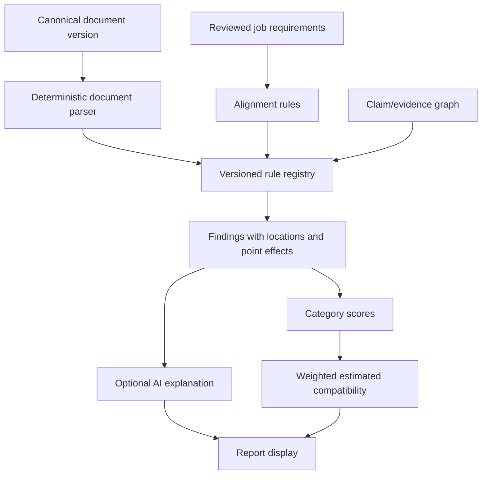

# ATS engine

Rules are pure functions over canonical typed content, reviewed requirements, and provenance—not rendered PDF guesses unless a format-specific parser check is requested. Each finding has stable rule ID/version, category, severity, location, measured value, threshold, remediation, and score effect. Rules that lack required inputs report `not_evaluated` and leave the denominator; they do not award default points.

Category weights and caps are defined in [scoring rubric](../ats/SCORING_RUBRIC.md). The engine prevents double penalties through rule groups/caps and reports raw/category/overall calculations. A ruleset version plus input hashes makes runs reproducible. AI may paraphrase the already-computed findings but receives no authority to add findings, alter severity, or change numbers.

The output is an estimated compatibility review, not an emulation of Workday, Taleo, Greenhouse, Lever, or any proprietary system and not a prediction of hiring outcome. See [limitations](../ats/LIMITATIONS.md).

## Current implementation boundary

M16 implements `ats-rules@1.0.0` as a pure TypeScript function over canonical document content, accepted requirements, explicit included evidence matches, and current claim/evidence status. It persists immutable report, category, and finding rows keyed by a complete input hash; repeated identical runs reuse the same report. The UI exposes raw earned/applicable points, weights, stable rule IDs, locations, measurements, thresholds, remediation, ruleset/input hashes, evaluation coverage, and export blockers.

Canonical checks cover all 15 weighted categories. Format-specific PDF/DOCX parse-back is intentionally joined in M17 because it requires the exact rendered artifact; an unavailable format check remains outside the denominator instead of receiving credit. Scoring never invokes a model. Optional AI wording remains deferred and cannot mutate stored values.
