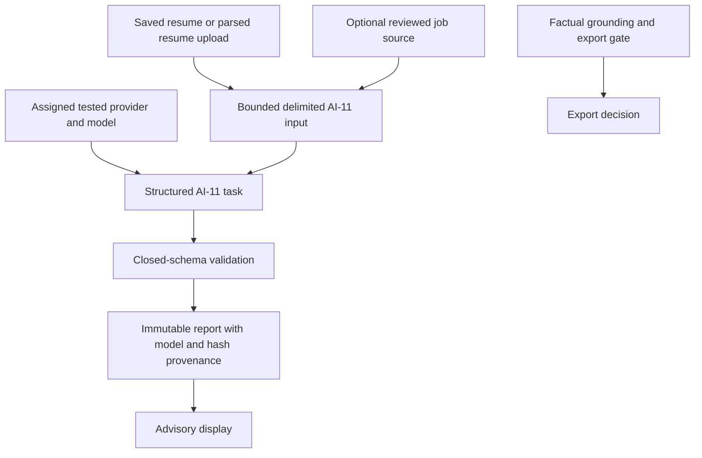

# AI ATS analysis

AI-11 is the only ATS analysis path. It receives bounded resume text and optionally the current normalized text of a reviewed job source. Imported text is delimited as hostile data and never enters the system prompt. Without a job, the model assesses parsing, formatting, readability, content, and impact. With a job, it must also assess job alignment.

The model returns `ai-11.v1` JSON containing an overall estimate, rationale, weighted categories, findings, location hints, and remediation. Local validation enforces the exact category set for the selected context, unique categories, integer score ranges, weights totaling 100, bounded strings and arrays, and known severities. Validation can reject output but does not calculate or replace the model's ATS score.

Reports are immutable and workspace-scoped. They record the provider configuration, configured model, task version, repair attempts, resume/job hashes, complete input hash, and validated output hash. The same resume/job/provider/model input reuses its existing report. Historical deterministic reports remain readable after migration but cannot be newly generated.

The report is an AI estimate, not an emulation of a named ATS and not a prediction of ranking or hiring. AI output never establishes evidence, changes claim support, marks an export eligible, or overrides the independent factual-grounding gate. See [ADR-0023](../adr/0023-ai-only-ats-analysis.md) and [limitations](../ats/LIMITATIONS.md).
