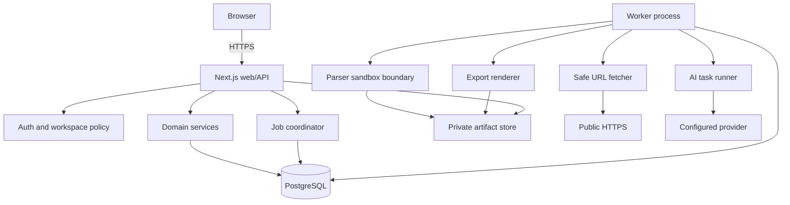

# Container and component design

## Web/API modules

- `auth`: sessions, bootstrap, CSRF, rate limiting, account lifecycle.
- `workspaces`: ownership policy and scoped repositories.
- `career`: entries, skills, proposals, evidence lifecycle.
- `documents`: logical documents, typed content, versions, claims, locks.
- `jobs`: postings, snapshots, requirements, matches.
- `tailoring`: runs, suggestions, acceptance and grounding gate.
- `ats`: versioned deterministic rules and reports.
- `providers`: configurations, task capability discovery, encrypted secrets.
- `artifacts`: opaque-key storage and authorized streaming.
- `portability`: archive export/import preview/deletion.

Domain modules expose application services and schemas; route handlers translate HTTP only. They cannot import a concrete model or storage SDK. Cross-module writes use a database transaction and outbox/job row where deferred work follows.

## Worker

The worker claims PostgreSQL job rows with `FOR UPDATE SKIP LOCKED`, leases/heartbeats, bounded attempts, idempotency keys, and typed results. Job types are parsing, URL retrieval, AI task, ATS batch, export, portability archive, and deletion. Interactive CRUD and suggestion acceptance remain synchronous. Heavy parsers may run in resource-limited child processes/containers; the worker treats crashes as typed failures.
