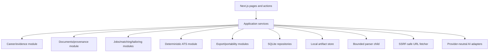

# Runtime and component design

The repository retains this filename for established links; the MVP has no deployment containers.

One bundled Node.js process hosts the Next.js UI/API and application services. Domain logic remains framework- and provider-independent. SQLite access is serialized through a process-local mutex; transactions, foreign keys, indexes, and triggers preserve aggregate invariants. Slow/untrusted parsing uses a bounded child process. URL fetching, AI calls, ATS work, export, portability, and deletion have explicit time/size/idempotency boundaries; no independently deployed worker is required.

Background operation rows remain useful for retry, status, and recovery, but are consumed by the local application. A second process must not open the same data folder concurrently. Move work out of process only after measured local latency/resource evidence and a new architecture decision.

Provider-specific transports implement shared task contracts. Artifact storage uses opaque local keys. UI/routes never access SQLite, provider transports, or filesystem paths without application/repository authorization.
