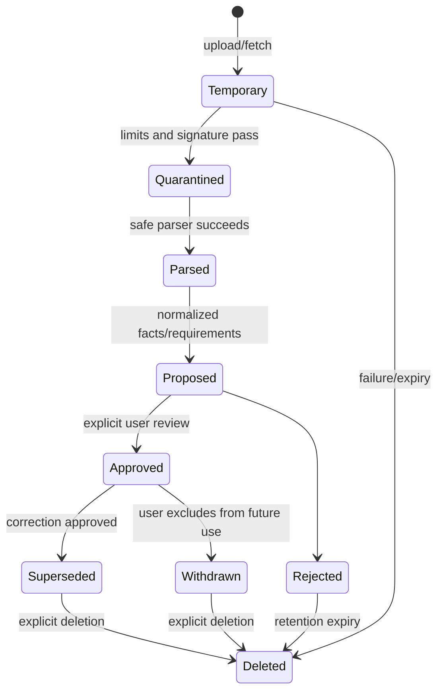

# Data lifecycle

Temporary uploads/fetches expire within 24 hours after terminal failure and are inaccessible to users except through the authorized operation. Parsed source bytes remain until the user deletes them or workspace policy expires them; approved facts do not depend on retaining bytes if the user selects binary-only deletion, but provenance displays that the original is unavailable.

Provider requests exist in worker memory only and are not logged or persisted as raw prompts. The project persists minimal task manifests, hashes, schema/prompt versions, usage counts, selected evidence IDs, and validated outputs needed for audit/versioning. External providers retain data according to their disclosed terms; the UI cannot promise deletion it does not control.

Exports use private temporary storage, become downloadable by short-lived authorized routes, and default to 24-hour artifact retention unless saved to the library. Audit metadata defaults to 90 days and excludes content. Job records retain coarse status for 30 days; task manifests referenced by document provenance remain with the version.

Workspace deletion is a durable, idempotent job: freeze writes, enumerate rows/keys, delete artifacts, delete relational aggregate, verify absence, issue receipt. Active deletion SLA is 24 hours; encrypted operator backups expire within 30 days. See [retention policy](../security/DATA_RETENTION_AND_DELETION.md).

## Implemented Career Information Bank lifecycle

M04 implements manual proposals, approval, supersession, withdrawal, archive, and permanent entry deletion. Approval records the actor, timestamp, typed value, source locator, and immutable UUID. A correction inserts a new fact that references the old fact and then marks the old fact superseded. Withdrawal excludes a fact from the approved-evidence query. Entry deletion first presents counts for facts, proposals, and skill links, requires an explicit `DELETE` confirmation, and removes the workspace-scoped graph in one transaction. Audit metadata contains identifiers and counts but no fact, entry, goal, or preference text.
