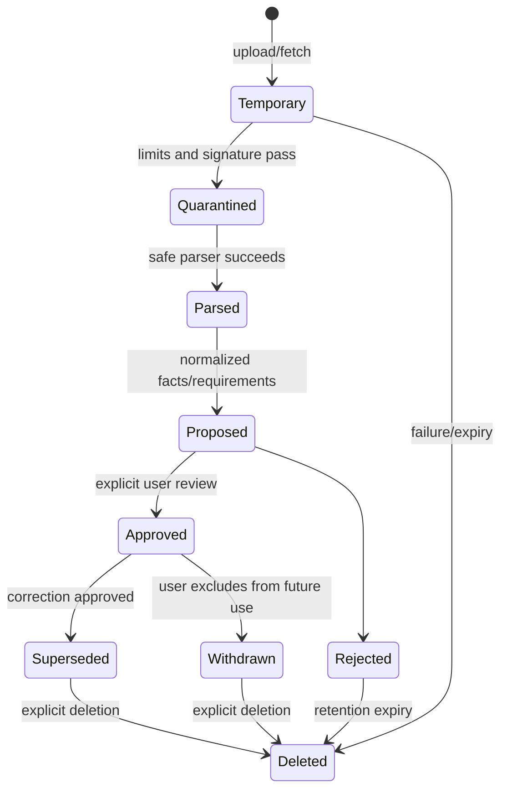

# Data lifecycle

Quarantined/parser inputs are bounded and cleaned on terminal handling. Ready source bytes remain until the user deletes them or deletes the workspace; approved facts do not depend on retaining bytes after binary-only deletion, but provenance displays that the original is unavailable.

Provider requests exist in process memory only and are not logged or persisted as raw prompts. The project persists minimal task manifests, hashes, schema/prompt versions, usage counts, selected evidence IDs, and validated outputs needed for audit/versioning. External providers retain data according to their disclosed terms; the UI cannot promise deletion it does not control.

Exports use private temporary storage, become downloadable by short-lived authorized routes, and default to 24-hour retention. Recurring maintenance removes expired rows/bytes and old unreferenced artifact files. Content-free audit rows, job-operation metadata, and task manifests remain with the workspace until aggregate deletion; no shorter automatic retention is currently implemented.

Workspace deletion is a durable, idempotent operation: freeze every ordinary insert/update/delete, persist a tombstone outside the relational aggregate, enumerate rows/keys, delete artifacts, delete the aggregate through an explicitly authorized connection, verify absence, and issue a receipt. It is attempted immediately and retried by startup/recurring maintenance. The app creates no backup; its reported backup-retention window is zero. See [retention policy](../security/DATA_RETENTION_AND_DELETION.md).

M18 persists the operation outside the workspace aggregate and writes a content-free tombstone to private storage before active erasure. Startup reconciliation is a safety barrier before principal access, and recurring maintenance retries partial failure/replays tombstones after restore. Portability schema version 1 supports semantic dry-run and empty-workspace import; see [data portability](DATA_PORTABILITY.md).

## Implemented Career Information Bank lifecycle

M04 implements manual proposals, approval, supersession, withdrawal, archive, and permanent entry deletion. Approval records the actor, timestamp, typed value, source locator, and immutable UUID. A correction inserts a new fact that references the old fact and then marks the old fact superseded. Withdrawal excludes a fact from the approved-evidence query. Entry deletion presents counts for facts, proposals, skill links, extraction batches, requirement-matching runs, tailoring runs, and saved document claims. A detail-page deletion requires `DELETE`; a card deletion requires a confirmation naming the complete selection and showing each impact. The repository then locks and rechecks the complete workspace-scoped selection and removes its deletable derived analysis graph and entries in one transaction. An entry supporting immutable saved document claims blocks the whole selection; the user can archive it without deleting document history. Audit metadata contains identifiers and counts but no fact, entry, goal, or preference text.

## Implemented job deletion lifecycle

M08 keeps each job revision immutable while allowing permanent deletion of an eligible whole job aggregate. Job cards preview revision, requirement-set, matching-run, tailoring-run, ATS-report, and URL-import counts and explicitly state whether accepted document versions block deletion. After a named confirmation, the repository locks and transactionally rechecks the complete workspace-scoped selection. Any missing, cross-workspace, or blocked job rolls back the entire selection. Eligible deletion removes URL-import metadata, ATS reports, uncommitted tailoring provenance, matching/requirement history, revision lineage, and the job record in dependency order through a narrowly scoped aggregate-deletion authorization. It does not delete separately managed uploaded source files. A tailoring run that produced an accepted document version blocks job deletion so immutable document provenance is not severed. Content-free audit metadata retains only the job ID and dependent counts.

## Implemented document deletion lifecycle

M05 keeps individual document versions immutable while allowing permanent deletion of a complete resume or cover-letter aggregate. Library cards preview counts for versions, claims, drafts, locks, tailoring runs, ATS reports, and private export artifacts, including artifact bytes and any unexpected cross-document history references. After the named confirmation, the repository locks and rechecks the complete workspace-scoped selection. Export bytes are first renamed from their live opaque keys to unreferenced opaque staging keys; database failure restores those keys, while commit removes the staged bytes. The authorized transaction deletes export metadata, ATS/tailoring state, drafts/locks, claim lineage, section projections, version lineage, and document records in dependency order. Missing, mixed-workspace, or externally referenced selections roll back as a unit. Downloaded copies outside the managed data folder remain under user control. Audit metadata contains only document IDs and dependent counts/byte totals.

## Implemented extraction-review lifecycle

M07 currently creates a workspace-scoped pending review batch from a ready parsed source. Recommended AI-01 extraction classifies exact spans into canonical section/item groupings. The `deterministic-sections@2` fallback recognizes common headings and blank-line item boundaries, removes common list markers, and retains the normalized source line number in every locator. Both paths store stable item keys so approval creates or reuses the correct Career Information Bank item. Pending proposals are not queried by the approved-evidence repository. A user may edit a pending proposal with optimistic revision checking, select one or more pending proposals for a confirmed approve or reject decision, or merge an exact duplicate with an existing approved fact. Resolution records the actor and time, is one-way at the database boundary, and completes the batch only after no pending proposals remain. Bulk approval and rejection are transactional, page-bounded, and limited to 20 unique proposals; the confirmation dialog names every selected proposal without requiring a manually entered count. Audit metadata contains identifiers and counts, never source or proposal text.
