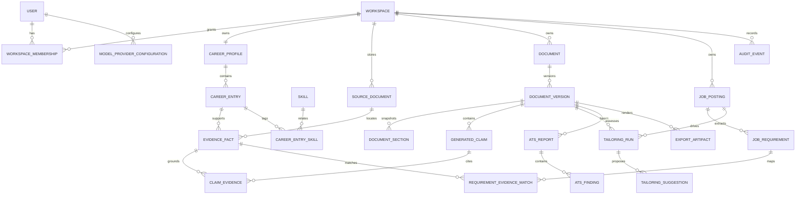

# Data model

The model uses UUID/ULID-style opaque IDs, UTC timestamps, explicit workspace ownership, optimistic revisions for mutable drafts, and immutable records for facts/snapshots/versions. Names are conceptual; migration design may refine columns without changing contracts.

## Current implementation boundary

M02–M18 implement identity/auth records, workspace/profile ownership, the Career Information Bank, documents, optimistic drafts, immutable versions, section projections, generated-claim/evidence links, locks, operational jobs, source/extraction/job records, reviewed requirements, append-only evidence matches/decisions, provider configurations, tailoring runs, pinned inputs/results/decisions, immutable ATS reports, private export-artifact manifests, portability, and deletion records. Ownership-sensitive relations use composite `(id, workspaceId)` foreign keys. Database triggers reject mutation of approved evidence content, document history, reviewed analysis, matching/provider/tailoring/ATS history, and export metadata; decision state is separately constrained.

Baseline migration 0001 includes the reference-scale Career Bank access paths: workspace/status/update/id ordering, normalized duplicate detection, and workspace/entry/status indexes for evidence and pending-proposal counts. Integrity migration 0002 adds cross-record context, immutable-history, canonical-storage-key, and frozen-workspace guards. The UI requests 25 entries at a time and computes counts with indexed scalar subqueries, preventing the 1,000-fact reference dataset from becoming an unbounded collection read.

## Important aggregates

- `CareerEntry` is mutable metadata until facts are approved. `EvidenceFact` is a canonical assertion with type/value/unit/date scope, source locator, approval record, status, and optional `supersedesFactId`; its value never changes.
- `SourceDocument` stores metadata, checksum, storage key, parser version, retention state, and proposals. Storage bytes are outside SQLite.
- `Document` is identity/metadata; `DocumentVersion` owns a full typed-content snapshot, parent, content hash, creation reason, and schema version. `DocumentSection` is a query projection/snapshot, not independently mutable.
- `GeneratedClaim` anchors a factual span/status to a version. `ClaimEvidence` is immutable and requires same-workspace facts. Nonfactual prose has explicit classification but no fake evidence.
- `JobPosting` represents one immutable normalized input snapshot plus revision lineage; reviewed requirements are immutable children. A corrected analysis creates a new snapshot/revision.
- `TailoringRun` pins task/prompt/schema/provider/model versions, base version, job revision, selected fact IDs, locked hashes, and status. Suggestions never modify a document directly.
- `ATSReport` pins one immutable document version, latest reviewed job revision/requirement set, ruleset version, and complete input hashes. `ATSCategoryScore` retains raw earned/applicable points and weights; `ATSFinding` retains ordered rule/category/severity/location/measurement/threshold/remediation and blocker state. Identical workspace/input hashes reuse a report.
- `ExportArtifact` pins a document version/hash, format, final/draft classification, fixed template/renderer version, complete support-state input hash, private opaque storage key, byte hash/size, warnings, requester, and 24-hour expiry. Metadata is immutable; M18 owns expiry/orphan cleanup and deletion reconciliation.
- `ModelProviderConfiguration` stores nonsecret endpoint/capabilities and encrypted secret envelope or environment reference; it is workspace-owned in MVP and records the creating user for audit.
- `AuditEvent` stores actor, action, target type/opaque ID, outcome, correlation ID, and coarse metadata—never content or secrets.
- `WorkspaceDeletionOperation` is a content-free receipt/lease outside the workspace FK aggregate so it survives erasure. The workspace write-freeze timestamp and private-volume tombstone make deletion retryable and restore-safe.

## Ownership and deletion

Every business row carries or derives a non-null `workspaceId`; repositories require it. Record-level deletion locks and rechecks the complete selection before a narrowly scoped transaction may cross immutable-history delete guards. Career-entry deletion removes its eligible evidence and derived-analysis graph but blocks if a saved document claim cites that evidence. Document deletion removes a complete `Document` aggregate, claim/version lineage, derived tailoring/ATS state, export metadata, and staged private export bytes; unexpected references from a document outside the selection block deletion, and individual versions cannot be selected. Job deletion removes an eligible complete `JobPosting` aggregate and derived requirement/matching/tailoring/ATS/import records but blocks if an accepted document version references its tailoring run; individual job revisions cannot be selected. These paths fail atomically for missing, mixed-workspace, or blocked selections and retain only content-free audit IDs/counts. Separately managed source files are never implicitly removed by job or document deletion. Workspace deletion freezes writes, erases private files and the relational aggregate, then retains only a content-free operation/tombstone. Historical provenance is retained only within the workspace; permanent deletion wins over history where the documented record-level blockers permit it. Source-binary-only deletion removes bytes and extracted text, sets source status to `deleted`, and marks locators unavailable while retaining approved assertions by explicit user choice. The opaque historical storage key remains non-dereferenceable metadata until workspace deletion. Database constraints prevent cross-workspace foreign keys through composite ownership keys where practical.
