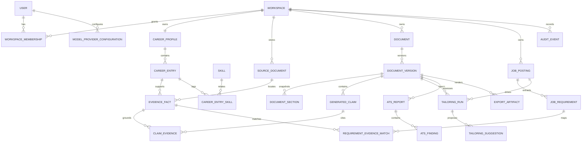

# Data model

The model uses UUID/ULID-style opaque IDs, UTC timestamps, explicit workspace ownership, optimistic revisions for mutable drafts, and immutable records for facts/snapshots/versions. Names are conceptual; migration design may refine columns without changing contracts.

## Current implementation boundary

M02–M10 and the in-progress M12 implement identity/auth records, workspace/profile ownership, the Career Information Bank, documents, drafts, immutable versions, section projections, generated-claim/evidence links, document locks, operational jobs, source documents, extraction reviews, job postings, immutable job revisions, URL-import operations, reviewed requirement revisions, model-provider configurations, and content-free audit events. Matching, tailoring, ATS, and export entities remain planned. Ownership-sensitive relations use composite `(id, workspaceId)` foreign keys. Database triggers reject mutation of approved evidence content, resolved extraction proposals, document history, job revisions, reviewed requirement revisions, and provider credential context.

## Important aggregates

- `CareerEntry` is mutable metadata until facts are approved. `EvidenceFact` is a canonical assertion with type/value/unit/date scope, source locator, approval record, status, and optional `supersedesFactId`; its value never changes.
- `SourceDocument` stores metadata, checksum, storage key, parser version, retention state, and proposals. Storage bytes are outside PostgreSQL.
- `Document` is identity/metadata; `DocumentVersion` owns a full typed-content snapshot, parent, content hash, creation reason, and schema version. `DocumentSection` is a query projection/snapshot, not independently mutable.
- `GeneratedClaim` anchors a factual span/status to a version. `ClaimEvidence` is immutable and requires same-workspace facts. Nonfactual prose has explicit classification but no fake evidence.
- `JobPosting` represents one immutable normalized input snapshot plus revision lineage; reviewed requirements are immutable children. A corrected analysis creates a new snapshot/revision.
- `TailoringRun` pins task/prompt/schema/provider/model versions, base version, job revision, selected fact IDs, locked hashes, and status. Suggestions never modify a document directly.
- `ATSReport` pins document/job/ruleset/content hashes. Findings carry rule/category/location/score impact.
- `ModelProviderConfiguration` stores nonsecret endpoint/capabilities and encrypted secret envelope or environment reference; it is workspace-owned in MVP and records the creating user for audit.
- `AuditEvent` stores actor, action, target type/opaque ID, outcome, correlation ID, and coarse metadata—never content or secrets.

## Ownership and deletion

Every business row carries or derives a non-null `workspaceId`; repositories require it. Workspace deletion cascades relational data and schedules artifact erasure. Historical provenance is retained only within the workspace; permanent deletion wins over history. Source-binary-only deletion nulls the storage key and marks locators unavailable but retains approved assertions by explicit user choice. Database constraints prevent cross-workspace foreign keys through composite ownership keys where practical.
