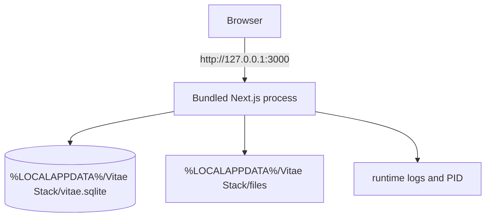

# Local deployment

The supported MVP deployment is one local process on one user's computer. The Windows x64 ZIP contains the production Next.js standalone output, parser child bundle, migration runner, launch scripts, notices/licenses, and Node.js 24.18.0. No installer, account, container runtime, or database server is required.

## Start and stop

`Start Vitae Stack.cmd` calls the PowerShell launcher, creates the data directories and encryption key with restricted permissions, applies forward SQLite migrations, starts the bundled server hidden, waits for the server startup marker while failing if the process exits, and opens the browser. The extracted-package smoke gate then verifies `/api/health` and `/api/ready` before exercising personal workflows. `Stop Vitae Stack.cmd` stops only that process and preserves the complete data directory.

The process must bind `127.0.0.1`; non-loopback configuration fails validation. It is not supported behind a reverse proxy, on a LAN address, or as a remotely hosted site because there is no login boundary.

## Storage and upgrade

Application binaries and user data are separate. Replacing the extracted release folder does not alter `%LOCALAPPDATA%\Vitae Stack`. Startup migrations are forward-only and checksum-protected using canonical LF line endings so checkout behavior cannot change migration identity; legacy CRLF-only checksum records are repaired to the canonical value. Before an upgrade, stop the app and copy the complete data folder. Rollback is application-binary rollback only when no incompatible migration has run; otherwise restore the coordinated pre-upgrade folder copy.

The default data path may be overridden with `VITAE_DATA_DIR` for testing or an explicitly chosen local location. Network shares and concurrent starts against the same data folder are unsupported.

## Release artifact

`scripts/personal/package.ps1` produces `dist/vitae-stack-personal-<version>-windows-x64.zip` and a SHA-256 record. CI builds and smoke-tests that package. Public signing and publication are maintainer release actions, not runtime prerequisites for users.
