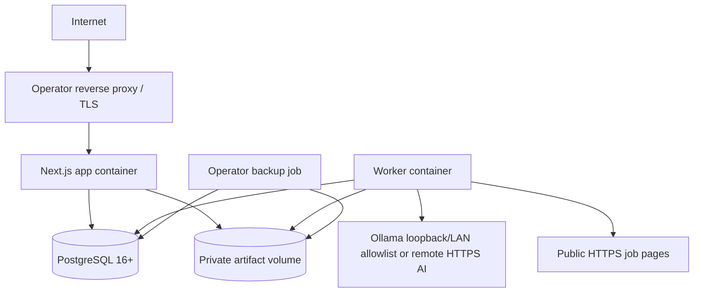

# Deployment

The current reference `docker compose` deployment has the app, PostgreSQL, and an explicit one-shot `migrate` profile on a private bridge network. The app is nonroot/read-only and receives only runtime database credentials; the migration container receives only migration credentials. The worker, artifact volume, resource limits, reverse-proxy example, and S3-compatible adapter arrive in later milestones. Host ports bind to loopback; direct internet exposure is not the default.

Development uses Node.js 24 LTS/pnpm on the host with Docker PostgreSQL, or the full Compose stack. This is the lightweight option: it avoids running the app/worker containers while keeping database parity. SQLite/PGlite is not an MVP runtime because dialect drift would weaken migrations and tests.

Production requires password auth, strong independent admin/migration/runtime credentials, encryption key, persistent PostgreSQL/artifacts, backups, public base URL, proxy allowlist, and egress controls. Startup validates unsafe combinations. Migrations are a one-shot release step with backup and compatibility window, never automatically run by every replica. The current development credentials in Compose are public examples and must be replaced.

For an upgrade, verify an encrypted `pg_dump` restore first, deploy schema-compatible code, run `docker compose run --rm migrate` once, and require `/api/ready` before traffic. If migration or validation fails, stop writes, restore into a fresh database, and run the prior compatible image. Committed migrations have no automatic down path.

Scale vertically first. Multiple app/worker replicas are possible using DB leases and shared S3-compatible artifacts, but high availability/Kubernetes is post-MVP. Air-gapped/local-only deployments disable URL fetching and use Ollama; no feature silently calls a cloud endpoint.
