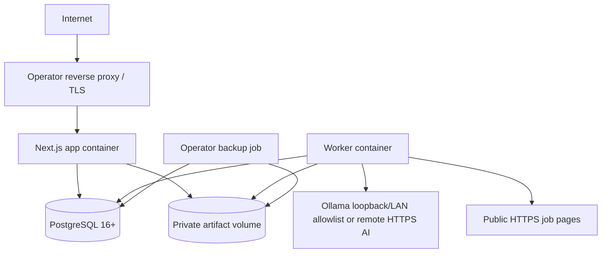

# Deployment



The current reference `docker compose` deployment has the app, PostgreSQL, a no-network parser sidecar, a public-egress job-fetch sidecar, a restricted deletion/replay worker, private artifact/result volumes, and an explicit one-shot `migrate` profile. The app is nonroot/read-only and receives only runtime database credentials; the migration container receives only migration credentials. The parser is nonroot/read-only, receives no database/provider credentials, mounts source bytes read-only, and has explicit memory/CPU/PID/file-descriptor caps. Its Go-backed transform helper is limited to two OS threads within the 64-PID container ceiling so cold execution does not compete with the resident worker for the entire PID budget. The job fetcher is also nonroot/read-only and resource-capped; it receives only a private queue volume, has no database/app-backend/artifact access or credentials, and applies the M09 public-address policy to its egress. The deletion worker has runtime database access and the three private volumes but no provider credentials or public host port. A general AI worker and S3-compatible storage are post-MVP; TLS reverse-proxy configuration remains operator-owned. Host ports bind to loopback; direct internet exposure is not the default.

Development uses Node.js 24 LTS/pnpm on the host with Docker PostgreSQL, or the full Compose stack. This is the lightweight option: it avoids running the app/worker containers while keeping database parity. SQLite/PGlite is not an MVP runtime because dialect drift would weaken migrations and tests.

Production requires password auth, strong independent admin/migration/runtime credentials, encryption key, persistent PostgreSQL/artifacts, backups, public base URL, proxy allowlist, and egress controls. Startup validates unsafe combinations. Migrations are a one-shot release step with backup and compatibility window, never automatically run by every replica. The current development credentials in Compose are public examples and must be replaced.

`compose.yaml` is the loopback development and source-build baseline. Published releases merge it with `compose.production.yaml`, which removes the PostgreSQL host port, requires every operator secret and version, and selects separate signed app/parser/fetcher/deletion/tools images by full tag-plus-digest reference. Copy `.env.production.example` to an access-restricted file outside Git, replace every value from the verified release `*.image.txt` records, URL-encode database-password reserved characters in connection URLs, and run:

```sh
docker compose -f compose.yaml -f compose.production.yaml --env-file .env.production pull
docker compose -f compose.yaml -f compose.production.yaml --env-file .env.production up -d postgres
docker compose -f compose.yaml -f compose.production.yaml --env-file .env.production run --rm --no-build migrate
docker compose -f compose.yaml -f compose.production.yaml --env-file .env.production up -d --no-build --wait app parser job-fetcher deletion-worker
```

Terminate TLS in a same-host reverse proxy that forwards only to the loopback app port and sets an allowlisted proxy chain. Verify release checksums, attestations, image digests/SBOMs, `/api/ready`, and backup recovery before admitting users. The base file's development passwords must never be used for personal data or an exposed deployment.

For an upgrade, verify an encrypted `pg_dump` restore first, deploy schema-compatible code, run `docker compose run --rm migrate` once, and require `/api/ready` before traffic. If migration or validation fails, stop writes, restore into a fresh database, and run the prior compatible image. Committed migrations have no automatic down path.

The reference backup procedure stops writes (or uses an operator-proven coordinated snapshot), creates a PostgreSQL custom-format dump, snapshots the complete private artifact volume including `.deletions/`, encrypts both with operator-managed keys, verifies hashes and a restore drill, and removes both no later than 30 days. A restore must restore both members of the pair, start the deletion worker before admitting users, wait for tombstone replay and deletion operations to settle, then start or enable the app. Restoring only the database is unsupported because source/export bytes and deletion tombstones would be missing. Backup scheduling and encryption tooling are operator-selected; Vitae Stack does not claim host-level backup automation. The repository includes conservative host-side reference commands and a drill checklist in [backup and restore operations](../operations/BACKUP_AND_RESTORE.md); restore refuses nonempty target volumes and is not an in-place overwrite tool.

Scale vertically first. Multiple app/worker replicas are possible using DB leases and shared S3-compatible artifacts, but high availability/Kubernetes is post-MVP. Air-gapped/local-only deployments disable URL fetching and use Ollama; no feature silently calls a cloud endpoint.
