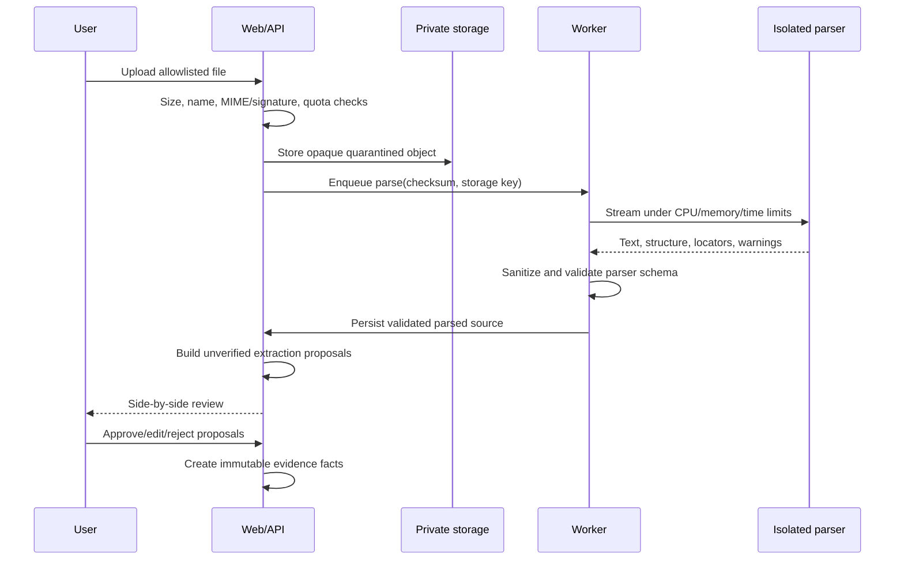

# Document pipeline

MVP accepts PDF, DOCX, UTF-8 Markdown/plain text, and project JSON. Extension, declared MIME, magic/signature, and parser result must agree. Default source limit is 10 MiB, 200 pages, 100k words, archive expansion 20 MiB/100 entries, parser wall time 30 seconds; operators may lower but not silently raise beyond tested hard caps.

PDF parsing extracts embedded text only; image-only pages are marked and OCR is post-MVP. DOCX is treated as an untrusted ZIP: reject encryption, macros, external relationships, excessive ratios/entries, and malformed XML; never invoke office software. Markdown/text are decoded with bounded UTF-8 normalization and rendered as text. JSON validates version/schema and previews conflicts before transaction.

Production parsers run in an externally network-restricted process/container with read-only input, an isolated writable temp directory, no database/provider credentials, restricted privileges, and bounded resources. Runtime permission flags are defense in depth, not the sandbox boundary. Current output contains normalized text, format metadata, and warnings. The deterministic extraction fallback uses exact normalized line locators; it does not infer original PDF pages. Richer parser locators may be added only when the parser can prove them. Prompt-like content remains data and is never promoted to instructions. See [file upload security](../security/FILE_UPLOAD_SECURITY.md).

M06 implements source metadata and private filesystem bytes, streaming upload validation, raw-text PDF/DOCX/Markdown/text/project-JSON parsing, escaped preview, authorized download, and permanent source deletion. The production parser exchanges schema-validated request/result envelopes through a dedicated private queue volume and cannot reach the application or database network. M07 currently adds bounded deterministic line proposals, source-to-proposal navigation, edit/approve/reject/duplicate-merge decisions, and counted bulk approval. AI-01 integration remains deferred to M12; the manual review flow does not require a provider. Parsed text and pending proposals remain explicitly unverified.
