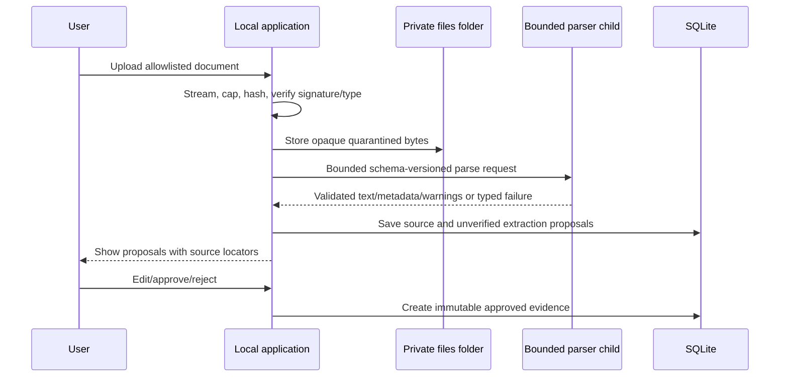

# Document ingestion pipeline

Supported inputs are PDF embedded text, DOCX, Markdown, plain text, and versioned project JSON. PDF extraction preserves parser-reported end-of-line boundaries so deterministic review proposals and source locators remain line-oriented. OCR, macros, scripts, remote resources, executable templates, and pixel-perfect layout recovery are excluded. Every trust boundary has byte, entry, decompression, text, and time limits.

The parser child receives no model-provider credential and returns a closed schema. Parser text is never approved automatically and prompt-like content stays inert. Approval records immutable evidence IDs and source locators; corrections create superseding facts.

After local parsing, the UI recommends a tested AI-01 provider for section/item extraction and discloses the destination/model and that the full bounded extracted text will be transmitted. A provider-independent `deterministic-sections@2` heuristic remains available as an explicit fallback. AI output is limited to exact source spans and stable item keys, locally schema/span/group validated, and persisted only as pending proposals with provider/model/hash metadata; neither path becomes evidence without review.

Source metadata is stored in SQLite while bytes use opaque names in the local files folder. Deleting bytes removes extracted source text and makes retained approved-fact locators unavailable. See [file upload security](../security/FILE_UPLOAD_SECURITY.md).
