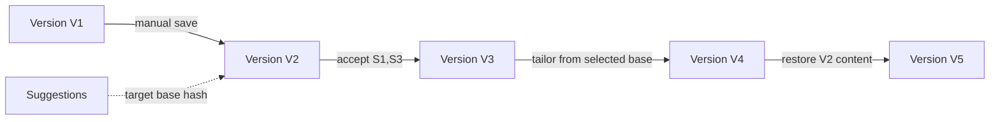

# Editor and versioning architecture

The canonical document schema is versioned JSON with stable block IDs and a restricted node vocabulary. A `DocumentVersion` is a complete immutable snapshot; diffs/projections can be cached but are not the source of truth. The current pointer on `Document` changes transactionally only after snapshot, claims, evidence links, and audit metadata validate.

Drafts are mutable and uniquely keyed by user/document/base version, with revision and expiry. Optimistic concurrency prevents silent overwrite. Suggestion acceptance locks the document aggregate, verifies base/version and locked hashes, applies operations to typed nodes, recalculates claims, validates schema/provenance, and commits a new version atomically.

Rendering never round-trips arbitrary HTML into the canonical model. Editor plugins cannot issue server requests or inject node types. Schema migrations preserve old readers or migrate versions in new records; no background rewrite without backup and checksum verification.

Comparison includes text, structure, formatting tokens, claim status, evidence links, and ATS delta. Restore is copy-forward. See [editor behavior](../design/EDITOR_BEHAVIOR.md) and [ADR-0011](../adr/0011-document-editor-architecture.md).

## Implemented M05 boundary

Migration 0005 stores a project-owned canonical JSON schema (version 1), complete immutable snapshots, stable section/block UUIDs, per-user optimistic drafts, projections, locks, claims, and same-workspace evidence links. Native labeled text controls provide the first keyboard/screen-reader editor and debounce-save drafts to a same-origin authenticated route. Manual version creation copies supported claim links only when the stable block text is unchanged; changed spans become unverified and lose evidence links; deleted spans do not appear in the new version. Restore copies content and provenance forward into a new child. The comparison view reports structural, text, claim-status, and provenance changes.

[Lexical](https://lexical.dev/) 0.46.0 was evaluated on 2026-06-29 as the preferred headless rich-editor layer for M15 because its official documentation describes JSON editor state, modular plugins, and accessibility goals. It is not installed in M05: persisted content remains the repository-owned schema, and dependency adoption is deferred until the M15 accessibility evaluation requires it.
