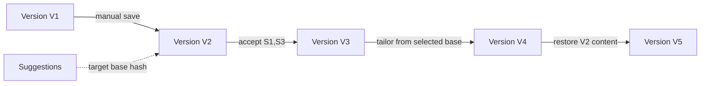

# Editor and versioning architecture

The canonical document schema is versioned JSON with stable block IDs and a restricted node vocabulary. A `DocumentVersion` is a complete immutable snapshot; diffs/projections can be cached but are not the source of truth. The current pointer on `Document` changes transactionally only after snapshot, claims, evidence links, and audit metadata validate.

Drafts are mutable and uniquely keyed by user/document/base version, with revision and expiry. Optimistic concurrency prevents silent overwrite. Suggestion acceptance locks the document aggregate, verifies base/version and locked hashes, applies operations to typed nodes, recalculates claims, validates schema/provenance, and commits a new version atomically.

Rendering never round-trips arbitrary HTML into the canonical model. Editor plugins cannot issue server requests or inject node types. Schema migrations preserve old readers or migrate versions in new records; no background rewrite without backup and checksum verification.

Comparison includes text, structure, formatting tokens, claim status, evidence links, and ATS delta. Restore is copy-forward. See [editor behavior](../design/EDITOR_BEHAVIOR.md) and [ADR-0011](../adr/0011-document-editor-architecture.md).

## Implemented M05 boundary

Baseline migration 0001 stores a project-owned canonical JSON schema (version 1), complete immutable snapshots, stable section/block UUIDs, per-user optimistic drafts, projections, locks, claims, and same-workspace evidence links; integrity migration 0002 adds contextual and immutable-history guards. Native labeled text controls debounce-save drafts to a same-origin authenticated route. On a concurrency conflict, saving pauses, the editor displays the local and server block text side by side, and the user explicitly chooses the server draft or reapplies the local draft against the reviewed server revision. Manual version creation copies supported claim links only when the stable block text is unchanged; changed spans become unverified and lose evidence links; deleted spans do not appear in the new version. Restore copies content and provenance forward into a new child. The comparison view reports structural, text, claim-status, and provenance changes.

[Lexical](https://lexical.dev/) 0.46.0 was evaluated on 2026-06-29 as a possible headless rich-editor layer because its official documentation describes JSON editor state and modular plugins. It is not installed: persisted content remains the repository-owned schema and the MVP native-control editor meets the required editing behavior without another dependency.

## Implemented M13 boundary

The document page can lock a section, block, or approved fact against its current hash. Run preparation validates every lock and derives the complete protected block set, including blocks protected indirectly by section, claim, or fact locks. Resume suggestions target one stable block and pin its base hash and before-text. The M13 review is intentionally read-only: no suggestion is accepted, rejected, regenerated, or written into a document version yet. Those state transitions and stale-base recovery remain M15 scope.

## Implemented M15 boundary

The review screen requires an explicit accept/reject decision for every pending suggestion. Accepted operations are applied together against the pinned base under a document/run lock and produce exactly one immutable `tailoring` version; rejecting all produces no version. Retry returns the prior result. Current document locks, pinned derived locks, source block hashes, evidence lifecycle, and workspace ownership are rechecked in the same transaction. A changed base rejects the commit and offers a new run.

Unedited accepted AI text becomes `supported` claims with copied candidate evidence. Any edited accepted nonempty block becomes one conservative `unverified` claim with no inherited evidence. The document screen exposes claim text/status/evidence and can resolve an unverified claim by linking a deterministically entailing approved fact or explicitly approving the exact claim as a new fact under a selected career entry. Either resolution creates another immutable version instead of mutating claim history. Native text controls retain browser undo/redo and the M05 optimistic autosave/version workflow; no rich-editor dependency was required for the MVP interaction contract.
