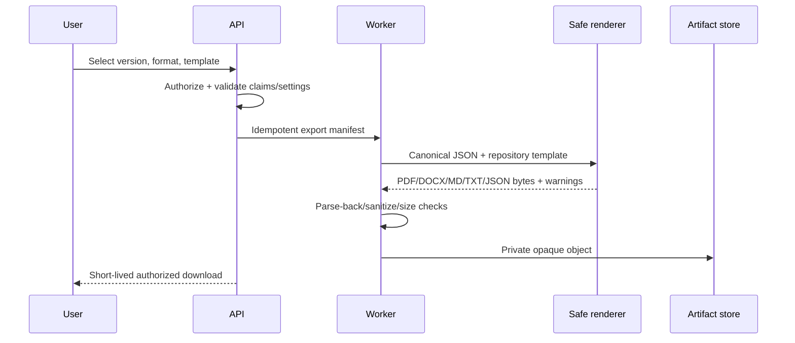

# Export pipeline

Repository-owned templates are data/configuration, not executable code. HTML rendering uses escaped content, fixed local assets, CSP, no network, JavaScript disabled where feasible, and a sandboxed headless Chromium process for PDF. DOCX uses a structured generator with headings/lists and no macros/external relationships. Markdown/text escape control content; JSON includes schema/provenance manifest.

Final PDF/DOCX requires supported claims. Draft Markdown/text/JSON may be permitted with visible/manifest warnings; draft PDF/DOCX is excluded from MVP to prevent accidental presentation as final. Output is virus/scanner-compatible, served as attachment with `nosniff`, and never rendered inline as trusted HTML.

Parse-back tests compare normalized text and structure. Visual snapshots cover pagination/overflow, while accessibility checks cover tagging/reading order to the extent libraries support it; limitations are disclosed. Artifacts default to 24-hour retention unless explicitly saved. See [export ADR](../adr/0012-export-strategy.md).
