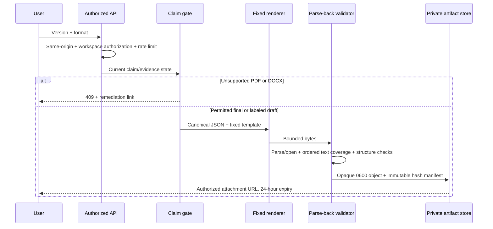

# Export pipeline

## Implemented M17 boundary

The MVP uses one repository-owned `ats-safe-single-column@2` template. PDFKit 0.19.1 emits selectable single-column PDF with document language, title metadata, ordered section/list writes, and an embedded subset of the bundled OFL-licensed Noto Sans 2.015 font. The bundled font prevents accented Latin, Greek, and Cyrillic names from degrading to replacement characters during extraction; rendering performs no font or network lookup. `docx` 9.7.1 emits macro-free OOXML using built-in heading and list semantics. Markdown escapes HTML and Markdown controls; text is plain UTF-8; JSON contains schema/classification/unsupported-claim manifest plus canonical content. No renderer executes user templates, HTML, scripts, subprocesses, or network requests.

Generation accepts an explicitly selected immutable version. A factual claim is export-eligible only when it is `supported`, has at least one evidence link, every linked fact remains approved, and its entry remains active. PDF/DOCX violations return a machine-readable 409 and an actionable claim-remediation link. Markdown/text/JSON remain available as drafts with a visible warning and manifest identifiers. Newly entered or changed manual blocks are conservatively tracked as unverified whole-block claims; empty initial blocks do not create claims.

Every output is capped at 10 MiB. PDF and DOCX are parsed back using the pinned ingestion parsers and must retain at least 98% of normalized source tokens in order. Tests also assert exact Unicode retention for representative punctuation and accented text, PDF metadata/selectable text, DOCX heading/list XML, absence of macros/external relationships, Markdown injection neutralization, and unsupported-claim blocking. Visual verification uses a two-page synthetic fixture to check margins, wrapping, hierarchy, continuation, clipping, and overlap.

Artifact metadata pins the document version/hash, renderer/template versions, support-state input hash, byte hash/size, classification, warnings, requester, and expiry. Identical active inputs reuse one immutable artifact. Bytes use opaque private filesystem keys with mode 0600 and are served only after workspace authorization and hash/size verification, as attachments with `nosniff`, `private, no-store`, and sandbox headers. Unsaved artifacts expire after 24 hours; M18 owns cleanup/deletion reconciliation.

Synchronous rendering is the smallest safe architecture for the bounded MVP input and measured renderer latency. SQLite advisory locks serialize identical work and the API limits each user to ten new artifacts per minute. The existing database-backed job boundary remains the recovery path if production measurements exceed request budgets. See [ADR-0018](../adr/0018-bounded-pdf-and-docx-renderers.md), [claim provenance](PROVENANCE_MODEL.md), and [retention](../security/DATA_RETENTION_AND_DELETION.md).
