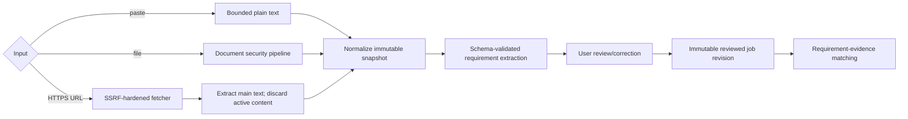

# Job-description pipeline

Pasted content is the preferred fallback. Files use the same allowlists and parser isolation as career sources. URL fetching accepts public HTTPS on ports 443 (and 80 only as an HTTPS redirect target policy exception if later approved); rejects credentials, IP literals by default, nonpublic/reserved destinations, and non-job content types.

The fetcher normalizes with the platform URL parser, resolves all A/AAAA records, rejects if any is disallowed, connects with DNS pinning/verified hostname, and repeats validation for each of at most three redirects. It sends no cookies/auth/referer, identifies a bounded generic user agent, accepts compressed bodies only with decompressed cap, limits to 5 MiB and 10 seconds, and never executes JavaScript. Dynamic pages requiring a browser must be pasted by the user; headless browsing is not an MVP fallback.

HTML is parsed with scripting disabled; scripts/styles/forms/iframes/images/remote resources are removed before main-text extraction. The original URL, retrieval time, final public origin, checksum, and safe warnings are recorded; raw network details are not shown. Imported instructions cannot alter system prompts or tools. See [URL security](../security/URL_FETCHING_SECURITY.md).
