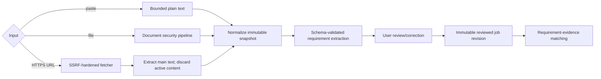

# Job-description pipeline

Pasted content is the preferred fallback. Files use the same allowlists and parser isolation as career sources. URL fetching accepts public HTTPS on ports 443 (and 80 only as an HTTPS redirect target policy exception if later approved); rejects credentials, IP literals by default, nonpublic/reserved destinations, and non-job content types.

The fetcher normalizes with the platform URL parser, resolves all A/AAAA records, rejects if any is disallowed, connects with DNS pinning/verified hostname, and repeats validation for each of at most three redirects. It sends no cookies/auth/referer, identifies a bounded generic user agent, accepts compressed bodies only with decompressed cap, limits to 5 MiB and 10 seconds, and never executes JavaScript. Dynamic pages requiring a browser must be pasted by the user; headless browsing is not an MVP fallback.

HTML is parsed with scripting disabled; scripts/styles/forms/iframes/images/remote resources are removed before main-text extraction. The original URL, retrieval time, final public origin, checksum, and safe warnings are recorded; raw network details are not shown. Imported instructions cannot alter system prompts or tools. See [URL security](../security/URL_FETCHING_SECURITY.md).

## Current implementation boundary

M08 implements pasted text and parsed-file input. It normalizes Unicode to NFC, line endings, trailing whitespace, excessive blank lines, null characters, and bidirectional controls; enforces 500,000 characters and 100,000 words; and stores a SHA-256-addressed immutable revision. Corrections create a child revision under an optimistic current-revision precondition. File revisions retain the private `SourceDocument` identifier and safe parser warnings, while the normalized snapshot remains usable if the user later deletes source bytes. Job-description sources are rejected by career-fact extraction so employer claims cannot become user evidence. A user may archive/restore a job or delete its complete aggregate from a named card confirmation after reviewing counts for revisions and derived analysis. The transaction rechecks the whole workspace-scoped selection, deletes eligible derived records in dependency order, and never deletes an individual revision. Accepted document-version provenance blocks deletion; uploaded source files remain separately managed.

M09 canonicalizes HTTPS-only URLs, rejects credentials/nonstandard ports/IP literals/local hostnames, classifies IPv4 and IPv6 special-use ranges, requires every resolved address to be public, and pins the validated address into the TLS request while retaining hostname verification. The bounded fetch primitive revalidates every redirect, permits three redirects, applies connection/total deadlines, caps headers/compressed/decompressed bodies and compression ratio, accepts only HTML/plain text and known encodings, sends no cookies or referer, and extracts inert text with `htmlparser2`. The local idempotent workflow enforces ten attempts per workspace-hour and stores status in SQLite. Safe failures retain paste/file fallback navigation.

M10 creates a workspace-scoped draft requirement set for the current immutable job revision through deterministic line analysis, manual entry, or AI-02. AI input is delimited as untrusted data; output uses a closed schema and must include exact UTF-16 source spans that match the stored snapshot. The shared provider runner bounds repair attempts and treats source-span failures as non-repairable. Users edit category, priority, text, and decision, then finalize only after resolving every proposal and accepting at least one. Finalized sets and their requirements are database-protected immutable revisions; corrections copy accepted items into a new draft. Unit, schema, synthetic evaluation, SQLite, browser, security, and production-build gates pass locally.

M11 builds versioned deterministic match runs from accepted requirements and approved facts belonging to active entries in the same workspace. `lexical-evidence@1` records normalized token overlap, exact-skill/phrase signals, a basis-point score, and direct/combined/weak strength; no proprietary ranking or model output affects the result. Requirements below threshold remain explicit gaps. Users append include/exclude decisions without rewriting the match history, and withdrawn/superseded or archived evidence cannot be newly included. The list-based matrix exposes evidence IDs, locator labels, signals, reasons, current lifecycle status, and evidence inspection links at narrow widths. Unit, schema, AI-03/04 smoke, SQLite, browser, and production-build gates pass locally.
