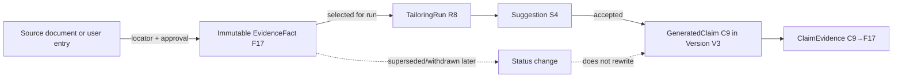

# Provenance model

## Contract

Every factual generated claim stores `claimId`, document version/block/offset anchor, exact normalized claim text/hash, status, tailoring run/task version, and one or more `ClaimEvidence` links. Each link names an immutable approved `evidenceFactId`, relation (`direct`, `combines`, `paraphrases`), and optional supporting span. IDs must belong to the same workspace and selected run context.

## Validation and editing

Schema validation checks IDs; semantic validation checks that evidence actually entails the factual content, with deterministic value/date/metric comparisons and task-specific checks. A model citation is a proposal, never proof. Conflicting facts block the claim unless the user resolves the conflict.

Version creation copies stable claim anchors and links. If text/structure changes, deterministic diff maps unchanged spans; overlapping factual changes become `unverified`. Users can link existing evidence or explicitly approve the edited assertion as a new evidence fact; provenance then points to that new immutable fact. Historical versions retain original support state at creation and also show current fact status (for example, “source later withdrawn”) without rewriting history.

Deleting a fact previews dependent claims/versions/exports. Permanent deletion removes dependent material or whole affected versions per user choice; it never leaves dangling IDs masquerading as support. Binary-only source deletion leaves the approved fact but marks the source locator unavailable. Final export requires every current factual claim status to be supported.

## Implemented M13 boundary

M13 stores claim candidates on immutable suggestions before document insertion. Each candidate has exact UTF-16 offsets and a hash of the proposed substring, and each evidence link must reference a fact pinned to the same workspace/run. Persistence revalidates the source section/block hash, locked derived block set, accepted requirement set, pinned evidence set, direct/combined match context, numeric tokens, lexical entailment, and complete claim coverage. The review UI renders the exact substring and links to each career entry while showing the evidence fact's current lifecycle status and source label. These records become version-bound `GeneratedClaim`/`ClaimEvidence` only when M15 applies an accepted suggestion.

M15 performs that conversion atomically. Exact accepted candidate spans become supported version claims and copy only their immutable evidence IDs. User-edited accepted text never inherits candidate evidence: the whole nonempty target block becomes unverified. Linking existing evidence or approving the exact edited text as a new fact creates a copy-forward version whose target claim is supported; unrelated text or changed numeric values fail the deterministic link check. Historical unverified and supported claims remain unchanged.

Manual version saves use the same conservative whole-block boundary. A new or changed nonempty block receives one unverified claim covering the complete block; prior partial support is not stretched across edited text. Users may explicitly mark text that makes no factual assertion as `nonfactual`. This resolution is copy-forward and auditable, while later edits revert the block to unverified.
