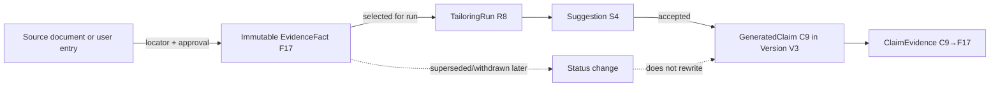

# Provenance model

## Contract

Every factual generated claim stores `claimId`, document version/block/offset anchor, exact normalized claim text/hash, status, tailoring run/task version, and one or more `ClaimEvidence` links. Each link names an immutable approved `evidenceFactId`, relation (`direct`, `combines`, `paraphrases`), and optional supporting span. IDs must belong to the same workspace and selected run context.

## Validation and editing

Schema validation checks IDs; semantic validation checks that evidence actually entails the factual content, with deterministic value/date/metric comparisons and task-specific checks. A model citation is a proposal, never proof. Conflicting facts block the claim unless the user resolves the conflict.

Version creation copies stable claim anchors and links. If text/structure changes, deterministic diff maps unchanged spans; overlapping factual changes become `unverified`. Users can link existing evidence or explicitly approve the edited assertion as a new evidence fact; provenance then points to that new immutable fact. Historical versions retain original support state at creation and also show current fact status (for example, “source later withdrawn”) without rewriting history.

Deleting a fact previews dependent claims/versions/exports. Permanent deletion removes dependent material or whole affected versions per user choice; it never leaves dangling IDs masquerading as support. Binary-only source deletion leaves the approved fact but marks the source locator unavailable. Final export requires every current factual claim status to be supported.
