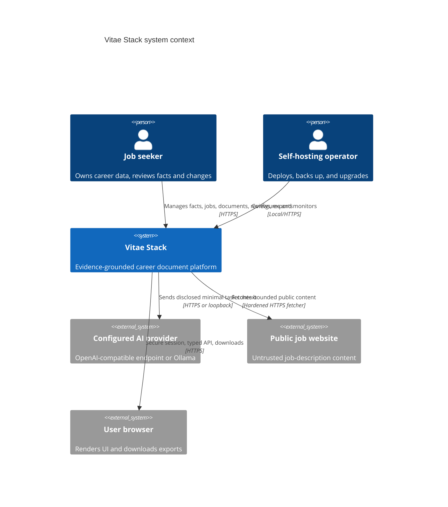

# System context

## Trust boundaries

Browser input, uploaded files, retrieved URLs, imported archives, templates, and model output are untrusted. The web application is an authorization boundary, not merely a UI backend. The worker has restricted database/storage access and no authority to bypass workspace or claim validation. AI providers are external data processors selected by the user; even loopback models are untrusted output producers.

The reference deployment has no required SaaS. Reverse proxy/TLS, S3-compatible storage, and remote AI endpoints are optional. SMTP is not required for closed personal deployment; operator-assisted password reset is documented until email is configured.
