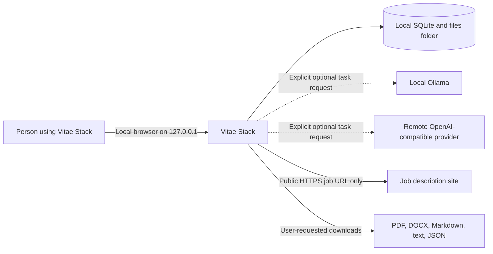

# System context

The user owns and operates the one local installation. No project account, cloud database, storage service, identity provider, email service, telemetry endpoint, or container runtime is required. The application binds only to loopback and is not a remote web service.

Remote AI is optional and explicit; the UI discloses the destination and data class before a task. Local Ollama and manual/deterministic workflows avoid remote model transmission. Job URL retrieval is limited by the SSRF policy. User-created downloads/backups leave the managed data boundary and remain under the user's control.
