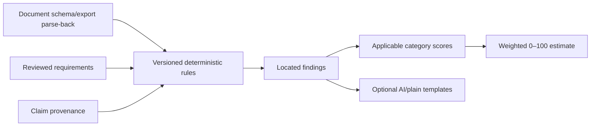

# ATS methodology

Vitae Stack provides a deterministic, versioned estimate of document parsing and job alignment. It does not reproduce a proprietary ATS, predict ranking, or know an employer's configuration. Results are advisory and explain their inputs, rules, and unavailable checks.

The engine evaluates canonical document structure, optional parse-back of an export, reviewed job requirements, and claim/evidence graph. Rules emit stable findings; categories normalize earned/applicable points; an overall weighted score combines applicable categories. AI may explain findings but cannot create, remove, reweight, or rescore them.

Scores are reproducible for identical input hashes/ruleset. `Not evaluated` checks leave the denominator and lower confidence/coverage rather than awarding points. Category caps prevent one repeated problem from dominating. Unsupported factual claims also block final export, independent of score.

The implemented `ats-rules@1.1.0` input hash covers the canonical document hash, reviewed job hash, accepted requirement identifiers/text/category/priority, current claim anchors/status/evidence status, and explicit included requirement/evidence matches. Stored reports are immutable and workspace-scoped. A reviewed match contributes to qualification coverage only when the same active approved evidence supports a current supported document claim; keyword presence by itself never earns evidence coverage.

See [rubric](SCORING_RUBRIC.md), [rules](PARSING_RULES.md), [alignment](JOB_ALIGNMENT_RULES.md), [quality](CONTENT_QUALITY_RULES.md), and [limitations](LIMITATIONS.md).
