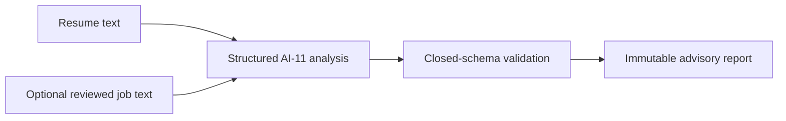

# ATS methodology

Vitae Stack provides an AI-generated estimate of resume compatibility and content quality. It does not reproduce a proprietary ATS, predict ranking, know an employer's configuration, or predict hiring.

The user selects a saved resume or ready parsed resume upload, an available provider/model assigned to AI-11, and optionally a reviewed job source. Resume and job text are bounded and sent as separately delimited untrusted data. Without a job source the model assesses general parsing, formatting, readability, content, and impact. With a job source it also assesses job alignment.

The model provides the overall 0–100 estimate, category scores and weights, rationales, findings, location hints, and remediation. Local validation requires the exact categories for the selected context, unique category keys, integer scores from 0 to 100, positive integer weights totaling 100, known severities, and bounded strings and arrays. Validation rejects malformed output but does not calculate a deterministic replacement score.

The report records provider configuration, configured model, `ai-11.v1` task version, attempts, resume/job hashes, input hash, and validated output hash. Identical resume/job/provider/model inputs reuse the immutable stored report. Changing any input or model creates a distinct analysis context.

AI analysis is separate from factual grounding. Scores and recommendations never establish approved evidence, change claim support, permit export, or override unsupported-claim blockers. An uploaded resume remains unapproved source text and does not become a saved document or export candidate.

See [output contract](SCORING_RUBRIC.md), [input guidance](PARSING_RULES.md), [job context](JOB_ALIGNMENT_RULES.md), [quality guidance](CONTENT_QUALITY_RULES.md), and [limitations](LIMITATIONS.md).
