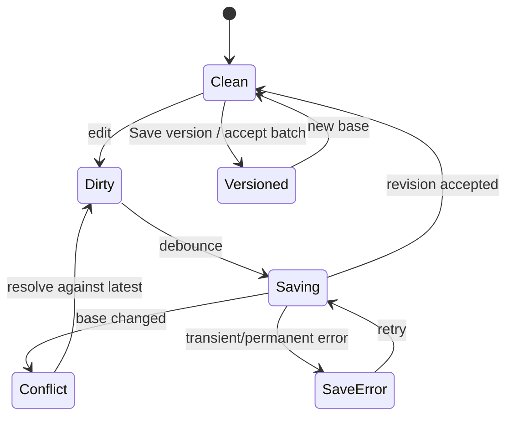

# Editor behavior

## Content model

The editor manipulates typed sections and blocks, not arbitrary HTML. Resume blocks include heading, contact, summary, experience, education, skills, project, and custom safe-text blocks; letters use header, salutation, paragraphs, closing. The persisted canonical form is JSON validated by versioned schemas. HTML is a rendered view and never authoritative.

## Saving and versions

Keystrokes update a client draft and debounce-save a server draft with optimistic concurrency (`baseVersionId` plus revision). Explicit **Save version**, accepted suggestion batches, restore, and tailoring outputs create immutable `DocumentVersion` records. A conflict offers compare/copy/reload; it never last-write-wins silently.

The editor exposes a live word count, announces autosave state, and warns through the browser's native leave confirmation while the current text differs from the last successful save. Browser-native undo/redo remains available inside the focused text field; immutable version history is the recovery mechanism after a committed save.

## Claims and suggestions

Claim anchors use stable block IDs plus text offsets and normalized content hashes. Nonsemantic formatting changes retain anchors. Text changes re-evaluate overlapping claims: unchanged spans retain links; changed factual spans become unverified; deletions tombstone links in the new version while history remains intact. A user can link evidence or approve the edited assertion as a new fact after explicit review.

The implemented editor applies a conservative trust-boundary rule: any newly nonempty or text-changed manual block becomes one whole-block `unverified` claim, even when no earlier generated claim overlapped it. This prevents newly typed assertions from bypassing the final-export gate. The user can link matching approved evidence, approve the exact text as a new fact, or explicitly classify framing/salutation/transition prose as `nonfactual`; each resolution creates a new immutable version. Unchanged supported and nonfactual anchors copy forward.

Suggestions are immutable operations against one base version. Accepting a stale suggestion is blocked. Bulk accept includes only individually visible, nonconflicting suggestions and creates one version. Locks apply to block IDs and claim/fact IDs; provider output touching locked hashes is rejected.

Paste is plain text by default. Safe structured paste may preserve paragraphs/lists after sanitization; scripts, styles, links with unsafe schemes, images, comments, and embedded objects are discarded. Undo/redo operates within the current draft; version history handles committed recovery.
