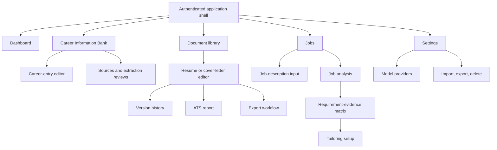

# Information architecture

## Primary navigation

Onboarding precedes the shell and creates/configures the first profile, storage disclosure, provider choice (which may be deferred), and import path. The active workspace and document/job context appear in breadcrumbs; object IDs never appear as user-facing labels.

## Content organization

- **Bank:** profiles, entries, facts, skills, goals/preferences, sources, verification queue.
- **Documents:** logical documents, type/status, current version, source/tailored lineage, exports.
- **Jobs:** immutable job snapshots, reviewed requirements, evidence matrix, tailoring runs.
- **Settings:** account/session, providers and data destinations, appearance/accessibility, deployment info, portability/deletion.

Deep links restore the selected tab and object but must reauthorize server-side. Search is workspace-scoped and distinguishes approved facts from proposals. Archive is a reversible view filter; delete is a separate destructive flow.

At 320–767 CSS px, primary navigation becomes a labeled menu, secondary panels become sequential pages/drawers, and evidence/details follow the controlled item. At 768–1199 px, two panes are allowed; at 1200+ px, editor/matrix may use three resizable panes. Reading and DOM order remain logical at every size.
