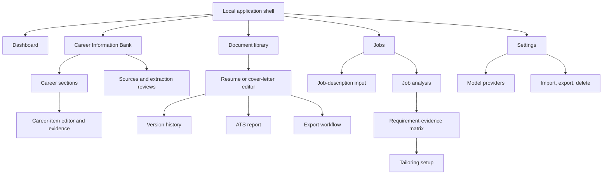

# Information architecture

## Primary navigation

On first use, the server automatically creates the opaque local principal, workspace, and profile; no onboarding or sign-in flow precedes the shell. The landing/dashboard links to manual/import/provider workflows, and provider setup may be deferred. Document/job context appears in breadcrumbs. Opaque IDs are not primary labels, although evidence/version identifiers are shown where provenance inspection requires them.

## Content organization

- **Bank:** canonical sections containing distinct career items; each item owns typed metadata, item notes, proposed/approved bullets and detailed factual context, skills, and provenance. Sources and the verification queue preserve the same section/item hierarchy.
- **Documents:** logical documents, type/status, current version, source/tailored lineage, exports.
- **Jobs:** immutable job snapshots, reviewed requirements, evidence matrix, tailoring runs.
- **Settings:** providers and data destinations, privacy/local deployment information, portability, and deletion.

Deep links restore the selected object and are always scoped to the server-derived workspace. Search is workspace-scoped and distinguishes approved facts from proposals. Archive is a reversible view filter; delete is a separate destructive flow.

At narrow widths, primary navigation and action groups wrap into a logical vertical sequence, tables use labeled item/card alternatives where implemented, and evidence/details follow the controlled item. Wider breakpoints may introduce two-column grids, but the current MVP does not use resizable multi-pane editors. Reading and DOM order remain logical at every supported width.
