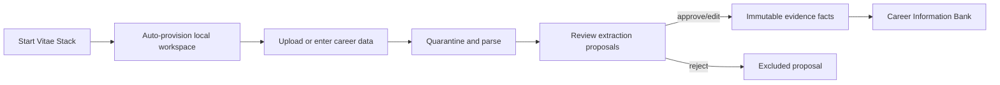
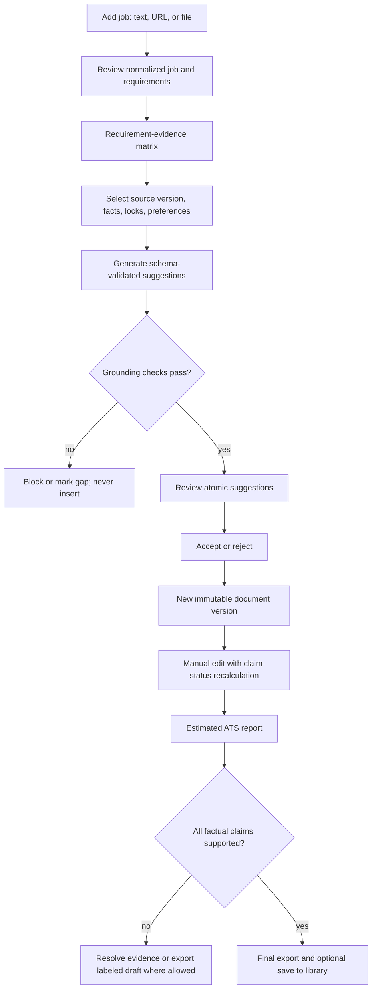

# User flows

## First value: import to approved evidence

The UI never labels parsed proposals as verified. Editing before approval changes the proposal; changing an approved fact creates a superseding fact.

## Tailoring

## Data deletion

The user selects scope, receives a dependent-count and consequence preview, confirms an explicit phrase, and receives a content-free operation ID. New writes are blocked while managed SQLite rows and files are deleted. The application cannot delete backup or export copies the user placed outside its data folder.

See [UX specification](../design/UX_SPECIFICATION.md) and [data lifecycle](../architecture/DATA_LIFECYCLE.md).
