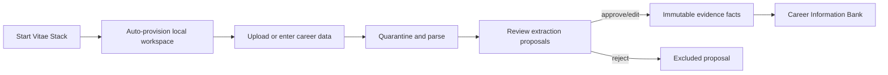
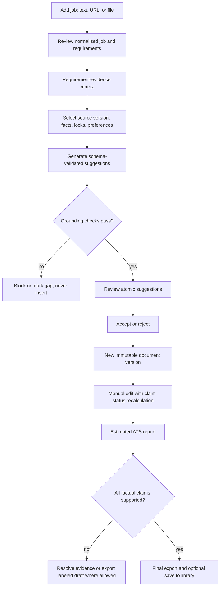

# User flows

## First value: import to approved evidence

The UI never labels parsed proposals as verified. Editing before approval changes the proposal; changing an approved fact creates a superseding fact.

## Tailoring

## Data deletion

For career entries, generated documents, and jobs, the user selects one or more named cards, receives a per-record dependency and blocker preview, and confirms the complete named selection. The server rechecks ownership and blockers in one transaction: an entry supporting saved document claims, a document with an unexpected cross-document history reference, or a job supporting an accepted document version blocks the entire selection. Otherwise the eligible aggregate and derived graph are deleted together; document deletion also stages and erases managed export bytes. Job-source uploads remain separately managed. Full local-data deletion uses the stronger explicit phrase and content-free operation receipt, blocks new writes, and removes managed SQLite rows and files. The application cannot delete backup or downloaded export copies the user placed outside its data folder.

See [UX specification](../design/UX_SPECIFICATION.md) and [data lifecycle](../architecture/DATA_LIFECYCLE.md).
