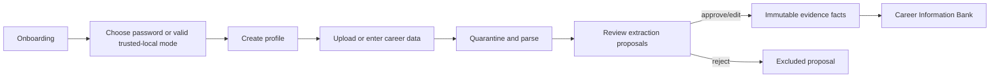
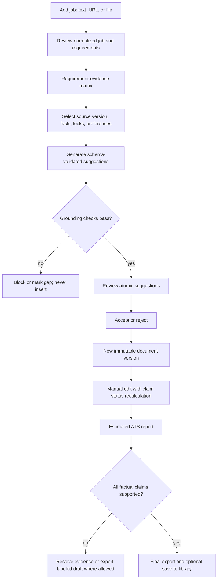

# User flows

## First value: import to approved evidence

The UI never labels parsed proposals as verified. Editing before approval changes the proposal; changing an approved fact creates a superseding fact.

## Tailoring

## Data deletion

The user selects scope, receives dependent-count and consequence preview, reauthenticates in password mode, confirms an explicit phrase, and receives a content-free operation ID. New writes are blocked for a workspace being deleted. Active database rows and artifacts are removed within 24 hours; backup expiry is reported as no later than 30 days.

See [UX specification](../design/UX_SPECIFICATION.md) and [data lifecycle](../architecture/DATA_LIFECYCLE.md).
