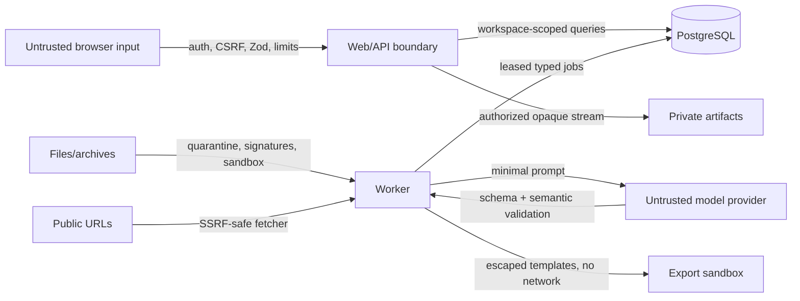

# Security architecture

## Security objectives

Protect confidentiality and tenant isolation of career/job documents and credentials; preserve integrity of evidence/provenance/versions; keep ingestion/provider/export work bounded; and make deletion, audit, and recovery verifiable. The system does not claim formal certification.

## Trust boundaries and controls

Defense layers: closed/default-deny configuration; session/reauth/rate limits; workspace-scoped services and composite ownership constraints; input/output schemas; file quarantine and parser isolation; SSRF egress policy; prompt injection separation; safe rendering; encrypted secrets; content-free logs; dependency pinning/audits; resource budgets; and security regression fixtures.

M03 implements the first identity layers: closed Better Auth password registration, UUID database sessions, database-backed rate limits, an explicit exact-origin guard for every unsafe auth method, generic login failures, non-echo/mounted-secret operator commands, session revocation on reset, trusted-local loopback validation, and a server-derived single-workspace principal. Integration tests exercise CSRF, brute force, enumeration, cookie flags, password hashing, session revocation, bootstrap reuse, trusted-local conversion, and cross-workspace denial.

Runtime and migration database roles are separate. Containers are nonroot, use read-only filesystems and minimal capabilities where practical, and receive only needed secrets. Artifact keys are random/opaque and private. Provider credentials are decrypted only in worker memory. Backups are encrypted and access-controlled by the operator.

Security-sensitive exceptions require owner, rationale, expiry, compensating control, and issue reference in the risk register. No critical/high known exploitable issue ships without explicit maintainer review. See [threat model](THREAT_MODEL.md) and [quality gates](../engineering/QUALITY_GATES.md).
