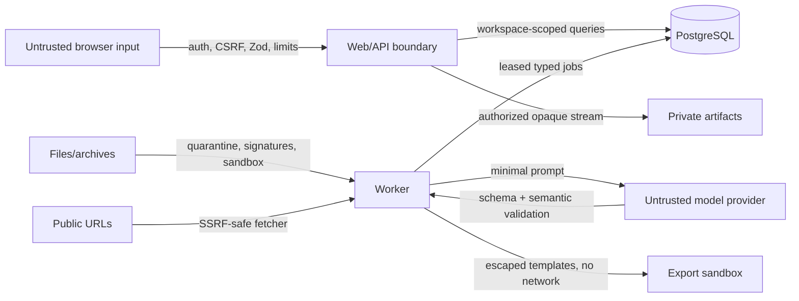

# Security architecture

## Security objectives

Protect confidentiality and tenant isolation of career/job documents and credentials; preserve integrity of evidence/provenance/versions; keep ingestion/provider/export work bounded; and make deletion, audit, and recovery verifiable. The system does not claim formal certification.

## Trust boundaries and controls

Defense layers: closed/default-deny configuration; session/reauth/rate limits; workspace-scoped services and composite ownership constraints; input/output schemas; file quarantine and parser isolation; SSRF egress policy; prompt injection separation; safe rendering; encrypted secrets; content-free logs; dependency pinning/audits; resource budgets; and security regression fixtures.

M03 implements the first identity layers: closed Better Auth password registration, UUID database sessions, database-backed rate limits, an explicit exact-origin guard for every unsafe auth method, generic login failures, non-echo/mounted-secret operator commands, session revocation on reset, trusted-local loopback validation, and a server-derived single-workspace principal. Integration tests exercise CSRF, brute force, enumeration, cookie flags, password hashing, session revocation, bootstrap reuse, trusted-local conversion, and cross-workspace denial.

Runtime and migration database roles are separate. Containers are nonroot, use read-only filesystems and minimal capabilities where practical, and receive only needed secrets. Artifact keys are random/opaque and private. Provider credentials are decrypted only in worker memory. Backups are encrypted and access-controlled by the operator.

M17 export mutations enforce exact origin, authenticated workspace ownership, allowlisted formats, immutable selected versions, ten-new-artifacts-per-minute limits, and a conservative current claim/evidence gate. Fixed PDF/DOCX/direct renderers execute no user template, HTML, script, subprocess, or network request; Markdown HTML is escaped and directional controls are removed. Generated bytes are size-bounded, parsed back, hashed, stored under opaque mode-0600 keys, reauthorized and integrity-checked on download, and delivered only as private `nosniff` attachments. Artifact metadata and audit events contain hashes/IDs/status, not document content.

M18 adds recent-authenticated full export/import/delete, streaming 50 MiB archive limits, an explicit portable-table allowlist, blob hashes, secret-field rejection, regenerated storage keys, write freeze, content-free tombstones, restore replay denial, retryable erasure, and aged orphan cleanup.

M19 hardening adds a unique per-request nonce CSP through the Next.js 16 proxy boundary, no inline-script exception, same-origin opener/resource policies, production HSTS, exact-origin protection and a 1 MiB declared-body bound on draft autosave, capability drops for the app container, expanded secret/static-danger scanning, and hashed database-backed limits for provider and portability work. CSP makes all HTML routes dynamically rendered; this privacy/integrity tradeoff is measured in M21. Production provider tasks allow 60 calls per owner per hour, provider tests 10, portability archives 5, and portability preview/apply checks 20; existing upload, URL, authentication, and export limits remain separate.

Security-sensitive exceptions require owner, rationale, expiry, compensating control, and issue reference in the risk register. No critical/high known exploitable issue ships without explicit maintainer review. See [threat model](THREAT_MODEL.md) and [quality gates](../engineering/QUALITY_GATES.md).
